# 什么样的数值结果值得相信

## ——以 Lorenz 系统为例

> 本文所有数字都由 `lorenz63` 包实际计算得出，图由 `lorenz63 figure all` 重建。
> 关键断言都写成了 `tests/` 下的测试。核心参数：σ=10, ρ=28, β=8/3。

---

## 0. 一个悖论开场

下面两条曲线来自**同一个方程、同一个初值、同一个求解器**（`scipy.solve_ivp` 的 DOP853），唯一的区别是相对容差：一个 `rtol=1e-6`，一个 `rtol=1e-12`。全文只用 DOP853，只调 rtol。

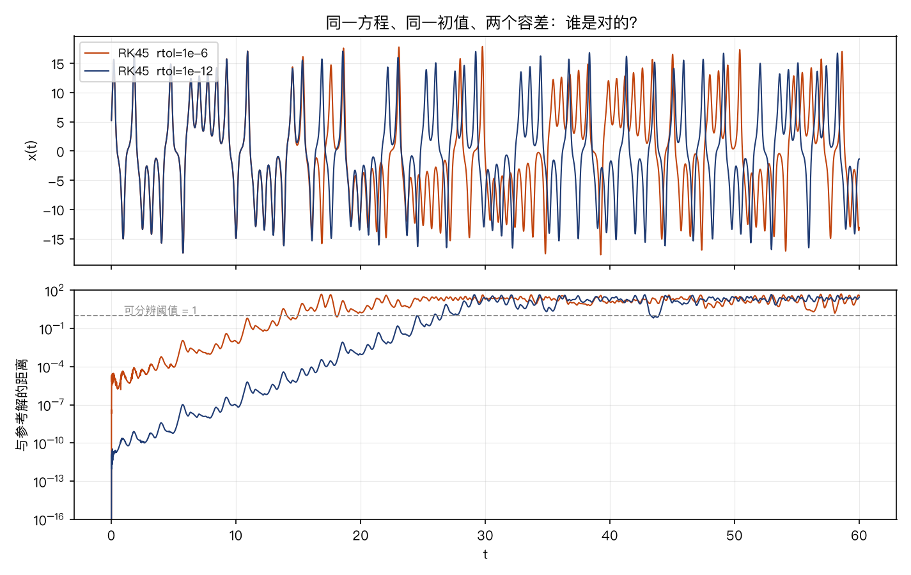

上图是 x(t)，下图是各自与一个更精确的参考解（DOP853, rtol=1e-13）的距离。两条轨道在前十个时间单位里贴合得很好，然后各自脱钩，此后完全无关——不是"差一点"，是差到吸引子的尺度。

这里出现了一个必须回答的问题：**哪一条是对的？**

直觉的回答是"容差紧的那条"。这个回答在 t<10 时正确，在 t>40 时毫无意义——本文的目的就是说清楚为什么，以及在它失效之后，我们还能对这个计算主张什么。

论证会经过四步：

1. Lorenz 是耗散系统，没有守恒量，**守恒系统那套「靠不变量验证」的办法在这里没有起点**；
2. 可预报时间被 Lyapunov 指数锁死，**精度只换来对数的时间**，这一条有一张直线图作为定量证据；
3. 尽管如此，**长时间统计量对容差完全不敏感**；
4. 所以判据要换：守恒系统看不变量，混沌系统看统计量。

---

## 1. 方程从哪里来，以及它不是什么

### 1.1 Rayleigh–Bénard 对流

厚度为 H 的流体层夹在两块水平板之间，底板比顶板热 ΔT。底部流体受热膨胀变轻、想上浮，顶部冷流体想下沉；粘性和热扩散抵抗这种翻动。两者之比是 Rayleigh 数

$$
\mathrm{Ra} = \frac{g\,\alpha\,\Delta T\,H^3}{\nu\,\kappa},
$$

g 为重力加速度，α 为热膨胀系数，ν 为运动粘度，κ 为热扩散率。Ra 低于临界值 Ra<sub>c</sub> 时流体静止、热量只靠传导；高于 Ra<sub>c</sub> 时静止态失稳，长出一排对流卷。另一个无量纲数是 Prandtl 数 Pr = ν/κ，即动量与热量各自扩散的快慢之比。

Boussinesq 近似下，沿卷轴方向均匀的二维流动由流函数 ψ（u = −∂ψ/∂Z，w = ∂ψ/∂X）和温度偏离线性传导剖面的部分 θ 描述（Lorenz 1963 式 17–18）：

$$
\frac{\partial}{\partial t}\nabla^2\psi = -\frac{\partial(\psi,\nabla^2\psi)}{\partial(X,Z)} + \nu\nabla^4\psi + g\alpha\frac{\partial\theta}{\partial X},\qquad
\frac{\partial\theta}{\partial t} = -\frac{\partial(\psi,\theta)}{\partial(X,Z)} + \frac{\Delta T}{H}\frac{\partial\psi}{\partial X} + \kappa\nabla^2\theta .
$$

这里用大写 X、Z 表示空间坐标：**X 水平，Z 竖直**（Z=0 底板，Z=H 顶板）。小写 x、y、z 留给 Lorenz 变量——它们是三个只随时间变的数，不是坐标。

### 1.2 三个变量：三种空间花样的振幅

**边界条件。** 上下板处要定三件事：

- 流体不穿板：w = 0；
- 板面温度固定：θ = 0（偏离量为零，板温就是 T₀+ΔT 与 T₀）；
- 切向怎么办，有两种取法。真实的固体板是**无滑移**：u = 0，贴板流体不动。**自由滑移**则是 ∂u/∂Z = 0：板面不受切应力，流体可以沿板自由滑——像两层流体的交界面，而不像墙。

换成流函数，自由滑移就是 ψ = 0 且 ∂²ψ/∂Z² = 0。好处在于 sin(nπZ/H) **一阶一阶地**满足全部条件：它在 Z=0、H 为零，二阶导 −(nπ/H)² sin(nπZ/H) 也为零。于是每个 Fourier 模态单独就是合法的，而且是 ∇² 的本征函数，PDE 的线性部分作用到它身上不产生新模态。无滑移要 ∂ψ/∂Z = 0，正弦不满足，得换成 Chandrasekhar 函数，Ra<sub>c</sub> 也从 657.5 变成 1708。自由滑移在物理上不如无滑移真实，但它让展开能用纸笔做完——Rayleigh 1916 起就是这样用的，Saltzman 1962 与 Lorenz 沿用。

在此边界下，Lorenz 把 ψ 与 θ 展开成 Fourier 级数，只保留三项（逐步推导见附录 C）：

$$
\frac{a}{(1+a^2)\kappa}\,\psi = \sqrt2\,x\,\sin\frac{\pi a X}{H}\sin\frac{\pi Z}{H},\qquad
\frac{\pi\,\mathrm{Ra}}{\mathrm{Ra}_c\,\Delta T}\,\theta = \sqrt2\,y\,\cos\frac{\pi a X}{H}\sin\frac{\pi Z}{H} - z\,\sin\frac{2\pi Z}{H},
$$

a 是卷的水平波数（以 π/H 为单位）。代回上面两式、向这三个模态投影，在时间 τ = π²(1+a²)κt/H² 下得到

$$
\dot x = \sigma(y-x),\qquad
\dot y = x(\rho - z) - y,\qquad
\dot z = xy - \beta z,
$$

$$
\sigma = \frac{\nu}{\kappa},\qquad
\rho = \frac{\mathrm{Ra}}{\mathrm{Ra}_c},\qquad
\beta = \frac{4}{1+a^2}.
$$

于是每个变量都是一种空间花样的振幅（图 18 上排）：

- **x**：对流卷翻滚得多快，正负是转向；
- **y**：上升流与下沉流之间的温差；
- **z**：水平平均温度剖面弯离直线的程度。它乘的模态 sin(2πZ/H) 只随**竖直坐标 Z** 变、不随水平坐标 X 变，所以它描述的是"把每一高度上的温度沿水平方向平均后，T̄(Z) 这条竖直剖面长什么样"。z>0 时下半层比直线凉、上半层比直线暖：中段被搅匀拉平，上下板附近变陡。
- **Nusselt 数**是"实际传热 ÷ 只靠传导时的传热"。热流穿过板面只能靠传导（板面 w=0），等于 −k ∂T̄/∂Z，所以 Nu 就是板面剖面的斜率与直线斜率 ΔT/H 之比。静止时剖面是直线，Nu=1；z 把板面附近压陡，Nu 跟着变大。在上式的标度下 **Nu = 1 + 2z/ρ**（附录 C 末尾有一行推导）。在 C<sub>±</sub> 处 z=ρ−1，Nu = 3 − 2/ρ：刚起对流（ρ=1）时为 1，ρ=28 时约 2.93，对流把传热提到传导的近三倍。这个式子最多到 3，而真实对流的 Nu 随 Ra 无界增长（约 Ra<sup>1/3</sup>）——截断在大 ρ 处失真的又一个迹象（§1.5）。

三者在不动点 C<sub>+</sub> 合起来是一对定常对流卷，热流体在两侧上升、冷流体在中间下沉（图 18 下排）。`tests/test_convection.py` 从重建的场直接检查两件事：板面温度梯度等于 1 + 2z/ρ；C<sub>±</sub> 处层平均的对流热流 ⟨wT⟩ 恰好补足 Nu − 1。

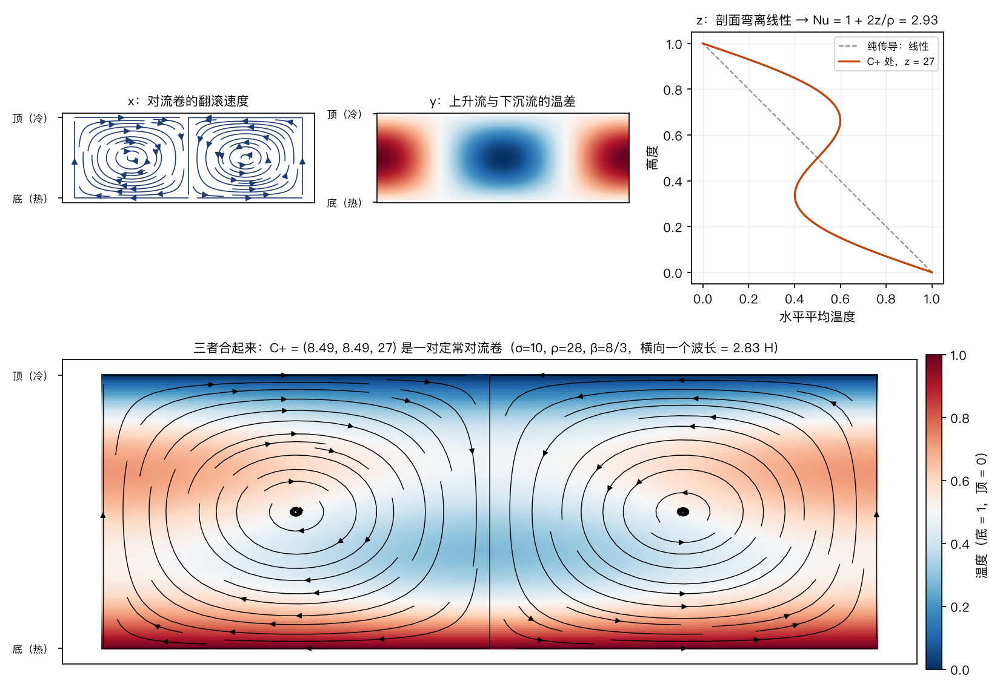

三个变量之间谁推谁，可以画成一张回路图（箭头上是方程里的项，§1.3 逐项解释）：

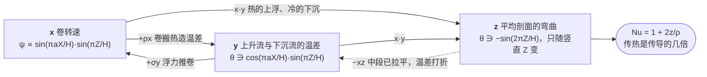

x 与 y 互相放大（实线回路）：这就是对流失稳。z 由 x、y 共同喂大，再反过来压 y（虚线）：这是让增长停下来的非线性刹车。三个变量各自还有一项自衰减（−σx、−y、−βz），图中省略。

### 1.3 每一项都是一个物理过程

| 方程 | 项 | 物理过程 |
|---|---|---|
| ẋ = σ(y − x) | +σy | 浮力：热的一侧轻、冷的一侧重，温差推着卷转 |
| | −σx | 粘性给翻滚刹车 |
| ẏ = ρx − y − xz | +ρx | 卷把底部热流体搬上去、顶部冷流体搬下来，制造水平温差；背景梯度越陡（ρ 越大）搬出的温差越大 |
| | −y | 热扩散把水平温差抹平 |
| | −xz | 剖面中段已被拉平，同样的翻滚搬来的温差打了折扣 |
| ż = xy − βz | +xy | 热的上升、冷的下沉，净效果是向上运热，把剖面拉弯 |
| | −βz | 热扩散把剖面拉回直线 |

线性项都是驱动或扩散；仅有的两个非线性项 −xz 与 xy 都来自平流 u·∇θ，即流体搬运温度。时间以热扩散为单位：a² = 1/2 时 π²(1+a²) ≈ 14.8，Lorenz 的 1 个时间单位约为 H²/κ 的 1/15。

换成秒（κ<sub>水</sub> ≈ 1.4×10⁻⁷ m²/s，κ<sub>空气</sub> ≈ 2.2×10⁻⁵ m²/s，室温）：

| 流体层 | H²/κ | 1 个 Lorenz 时间单位 | 多一位精度换来的 2.55 单位（§5.3） | 达到 ρ=28 所需 ΔT（自由滑移） |
|---|---|---|---|---|
| 水，H = 1 cm | 700 s | 约 47 s | 约 2 min | 约 1.3 K |
| 水，H = 5 cm | 4.9 h | 约 20 min | 约 50 min | 约 0.01 K |
| 空气，H = 5 cm | 114 s | 约 8 s | 约 20 s | 约 1.5 K |
| 空气，H = 10 cm | 455 s | 约 31 s | 约 80 s | 约 0.2 K |

量级记法：**1 cm 水层，一个时间单位约一分钟**。H 加倍时间放大四倍，所需 ΔT 缩小八倍（Ra ∝ H³）。这张表只给时间尺度的直觉；ρ=28 的真实流体早已不是三模态（§1.5），不能拿它预报实验。

### 1.4 经典参数 σ=10, β=8/3, ρ=28 的来由

三个数都出自 Lorenz 1963 原文，此后的文献几乎都沿用，本文所有实验也用这一组。

- **β = 8/3**：自由滑移边界下，波数为 a 的卷在 Ra<sub>c</sub>(a) = π⁴(1+a²)³/a² 失稳，最小值在 a² = 1/2，Ra<sub>c</sub> = 27π⁴/4 ≈ 657.5。取最先失稳的那种卷，β = 4/(1 + ½) = 8/3，卷宽 √2 H。`tests/test_convection.py` 对 Ra<sub>c</sub>(a) 数值求最小，检查它落在 β = 8/3 上。
- **σ = 10**：与水同一量级（室温约 7）。它还须大于 β + 1 = 11/3：§2.3 的 Hopf 阈值 ρ<sub>H</sub> 的分母是 σ − β − 1，非正时 C<sub>±</sub> 永不失稳，没有混沌吸引子。
- **ρ = 28**：Ra 是临界值的 28 倍，略高于 ρ<sub>H</sub> = 470/19 ≈ 24.74，三个不动点全部不稳定（§2.3）。

### 1.5 它不是什么

**诚实点 1：ρ=28 时这个截断早已不再忠实于对流。**

三模截断只在 ρ 略大于 1（刚过对流失稳阈值）时有渐近依据。到了 ρ=28，被丢掉的高阶模态在真实流体里已经被强烈激发，Lorenz 方程与 Rayleigh–Bénard 的定量联系断了。它此后是一个**自洽的数学对象**，不是一个流体模型。

这一点值得强调，因为大量介绍性材料会说"Lorenz 方程描述大气对流，所以天气不可预报"。正确的说法要弱得多：Lorenz 方程展示了**低维确定性系统也能有敏感依赖**，这个定性教训可以迁移到大气；方程本身不能。本文后面所有结论都是关于这个数学对象的，不涉及任何流体主张。

另一方面，确有几个物理系统化简后**恰好**是这组方程，变量重新标度后对应关系是精确的，只是 σ、β、ρ 换成装置自己的参数：Malkus 水车（x 是转速，y、z 是桶中水量分布的一阶 Fourier 系数）、竖直圆环热虹吸管（x 是环流速度）、单模激光（Haken 1975：x 是光场，y 是极化，z 是粒子数反转）。

---

## 2. 定性结构：耗散、有界、三个不动点

### 2.0 工具回顾：相空间、线性化、Liouville、辛

**相空间。** 状态 u = (x, y, z) 是 ℝ³ 里的一个点。方程 u̇ = f(u) 在每个点上放一支箭头（速度），轨道就是顺着箭头走的流线。时刻 t 把每个初值送到它 t 时刻的位置，这个映射叫流 φ<sub>t</sub>。确定性意味着流线不相交：同一个点只有一支箭头。

**线性化。** 在一条轨道 u(t) 旁边放一个小扰动 u + δu，把 f 泰勒展开到一阶：

$$
\dot{\delta u} = J(u(t))\,\delta u,\qquad J_{ij} = \frac{\partial f_i}{\partial u_j}.
$$

J 的第 i 行回答"第 i 个变量的变化率，对三个变量各自有多敏感"。逐行对 Lorenz 求偏导就得到下面 2.1 的矩阵。J 随轨道变，所以这是一个**变系数**线性方程；只有在不动点处 J 是常数，解才是 Σ c<sub>k</sub> e<sup>λ<sub>k</sub>t</sup> v<sub>k</sub> 的形式（2.3）。

**Liouville 公式。** 把三个扰动排成矩阵 M(t)，M′ = J M、M(0) = I。三个列向量张成的平行六面体体积是 det M，它满足

$$
\frac{\mathrm d}{\mathrm dt}\det M = \operatorname{tr} J \cdot \det M,
\qquad
\det M(t) = \exp\!\int_0^t \operatorname{tr} J\,\mathrm dt'.
$$

tr J 就是向量场的散度 ∇·f：一小团初值的体积以 ∇·f 的速率胀或缩。

**辛结构。** 理论力学里的哈密顿系统 q̇ = ∂H/∂p、ṗ = −∂H/∂q 有 ∇·f = ∂²H/∂q∂p − ∂²H/∂p∂q = 0，于是相体积守恒（Liouville 定理）。辛比体积守恒更强：流保持 Σ dq<sub>i</sub>∧dp<sub>i</sub>，每一对 (q<sub>i</sub>, p<sub>i</sub>) 平面上投影的有向面积之和守恒；写成矩阵是 MᵀΩM = Ω。它带来几个后果：相空间维数必须是偶数；Lyapunov 指数成对出现（λ 与 −λ）；没有吸引子，因为吸引子要把一团体积挤到零。

Lorenz 在三条上都不沾边：维数是 3（奇数），散度处处为负，有吸引子。下面 2.1 把散度算出来。

### 2.1 相空间体积以固定指数率坍缩

逐行求偏导。三个方程是

$$
\dot x = \sigma(y-x),\qquad \dot y = x(\rho-z) - y,\qquad \dot z = xy - \beta z .
$$

- 第一行：σ(y−x) 对 x、y、z 求导，得 −σ、σ、0；
- 第二行：xρ − xz − y 对 x 求导得 ρ−z，对 y 得 −1，对 z 得 −x；
- 第三行：xy − βz 对 x 求导得 y，对 y 得 x，对 z 得 −β。

排起来就是 Jacobian

$$
J = \begin{pmatrix} -\sigma & \sigma & 0 \\ \rho - z & -1 & -x \\ y & x & -\beta \end{pmatrix}
$$

线性项求导得常数；非线性项 xz、xy 求导后留下 x、y、z，所以 J 随轨道上的点变。本文后面三次用到它，读的是它的三个不同侧面：

- **对角线**：迹与点无关，下面就是体积（本节）；
- **在不动点上**：J 是常数，看特征值（§2.3、§3.2）；
- **沿着轨道**：J 每一点都不同，没有固定的本征方向可用，要边走边正交化（§3.4）。

它的迹在**任何一点**都是

$$
\operatorname{tr} J = -(\sigma + 1 + \beta) = -13.6666666667
$$

这是一个常数。对角线上的 −σ、−1、−β 正是 §1.3 的粘性与两项热扩散；两个非线性项 −xz、xy 都不在对角线上（ẏ 里的 xz 不含 y，ż 里的 xy 不含 z），对散度没有贡献——**搬运只挪体积，耗散才缩体积**。由 Liouville 公式，任意相空间体积按 $e^{-13.667\,t}$ 均匀收缩：2 个时间单位内缩小到 $1.35\times 10^{-12}$。

这件事可以直接验证。令 $M' = J M,\ M(0)=I$，则 $\det M(t)$ 就是体积增长因子。下图把 Lorenz 与一个谐振子（哈密顿系统，$\operatorname{tr}J = 0$）放在一起：

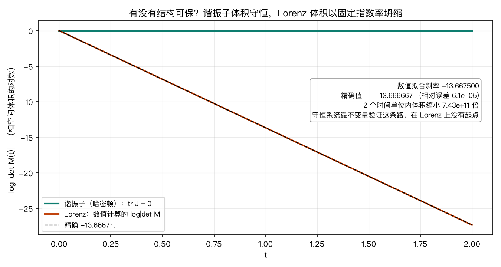

谐振子那条线严格贴在 0 上——辛结构的直接后果，面积守恒。Lorenz 那条线线性下降，对它拟合得到斜率 **−13.667500**，与解析值 −13.666667 的相对误差 $6.1\times 10^{-5}$。

**这张图就是本文第 4 节的全部前提**：Lorenz 没有守恒量，没有辛形式，没有作用量–角变量。凡是"用不变量检验积分器"的验证策略，在这里连出发点都找不到。问"该用辛方法吗"在 Lorenz 上是个空问题——要保的结构不存在。

### 2.2 但它有界

耗散不等于收缩到一点，也不等于不会跑到无穷。取

$$
V = \rho x^2 + \sigma y^2 + \sigma (z-2\rho)^2
$$

沿流求导得到

$$
\frac{\mathrm dV}{\mathrm dt} = -2\sigma\left[\rho x^2 + y^2 + \beta(z-\rho)^2 - \beta\rho^2\right]
$$

方括号在椭球 $\rho x^2 + y^2 + \beta(z-\rho)^2 = \beta\rho^2$ 之外为正，于是 $V$ 在那里单调下降。所有轨道最终被困在一个有界区域内。**局部指数分离 + 全局折叠回来**——这正是混沌的定义，而不是发散。

### 2.3 不动点与分岔

分三步：找出不动点；在每个不动点把方程线性化；看特征值的实部。

**第一步：令三个导数为零。**

$$
\sigma(y-x)=0 \;\Rightarrow\; y=x;\qquad
xy=\beta z \;\Rightarrow\; z=\frac{x^2}{\beta};\qquad
x(\rho-z)-y=0 \;\Rightarrow\; x(\rho-1-z)=0 .
$$

最后一式给两条路：x = 0，得原点；或 z = ρ−1，代回 z = x²/β 得 x² = β(ρ−1)，只在 ρ>1 时有实根：

$$
C_\pm = \left(\pm\sqrt{\beta(\rho-1)},\ \pm\sqrt{\beta(\rho-1)},\ \rho-1\right) = (\pm 8.485281,\ \pm 8.485281,\ 27)
$$

心算：β(ρ−1) = 8/3 × 27 = 72，√72 ≈ 8.49。物理上，原点是**静止导热**（不动、温度是直线）；C<sub>±</sub> 是**定常对流卷**，正负号是顺时针还是逆时针转，方程对 (x,y,z)→(−x,−y,z) 对称，所以两者成对出现。

**第二步：原点的稳定性。** 在原点 J 是常数，扰动按 e<sup>λt</sup> 走，λ 是 J 的特征值；有一个实部为正，就有一个方向会长大，不动点就不稳定。

$$
J(0) = \begin{pmatrix} -\sigma & \sigma & 0 \\ \rho & -1 & 0 \\ 0 & 0 & -\beta \end{pmatrix}
$$

z 自己分出去，λ = −β。剩下的 2×2 块满足 λ² + (σ+1)λ + σ(1−ρ) = 0。两根之积是 σ(1−ρ)：ρ<1 时为正，两根同号且和为负，都负，稳定；ρ>1 时为负，一正一负，鞍点。所以 **ρ = 1 正是对流起来的那一刻**——ρ = Ra/Ra<sub>c</sub> 的归一化就是为了让这个阈值落在 1。ρ=28 时 λ = (−11 ± √1201)/2，√1201 ≈ 34.66，得 +11.83 与 −22.83。

**第三步：C<sub>±</sub> 的稳定性。** 在 C<sub>+</sub> 处 ρ − z = 1，记 x\* = √(β(ρ−1))：

$$
J(C_+) = \begin{pmatrix} -\sigma & \sigma & 0 \\ 1 & -1 & -x^* \\ x^* & x^* & -\beta \end{pmatrix},
\qquad
\lambda^3 + (\sigma+\beta+1)\lambda^2 + \beta(\sigma+\rho)\lambda + 2\sigma\beta(\rho-1) = 0 .
$$

（下面用到的三次多项式知识，逐条见附录 D。）三个系数在 ρ>1 时全为正，所以没有正实根：λ ≥ 0 时每一项都 ≥ 0，常数项 2σβ(ρ−1) 严格为正，左边 > 0；λ = 0 也不是根。但"没有正实根"不等于稳定，复根的实部仍可以为正。系数全正只是必要条件：λ³ + λ² + λ + 2 系数全正，实根约 −1.35，三根之和是 −1，那对复根的实部就是 (−1 + 1.35)/2 ≈ +0.18。

所以要看根怎么随 ρ 移动。根随系数连续变化。ρ 刚过 1 时，常数项很小，有一个根刚从 0 往左走（就是原点处过零的那个根），另两个是负的，C<sub>±</sub> 稳定。之后要失稳，必须有根穿过虚轴 Re λ = 0。从 λ = 0 穿不过去（它不是根），于是只能在 ±iω（ω ≠ 0）处穿过；系数是实的，复根共轭成对，所以是**一对复根一起穿过虚轴**，这就是 Hopf。记 λ³ + a₂λ² + a₁λ + a₀，令 λ = iω 代入，(iω)³ = −iω³，(iω)² = −ω²：

$$
p(i\omega) = (a_0 - a_2\omega^2) + i\,\omega\,(a_1 - \omega^2) = 0 .
$$

实部、虚部分别为零：

$$
\text{虚部：}\ \omega^2 = \beta(\sigma+\rho);\qquad
\text{实部：}\ (\sigma+\beta+1)\,\omega^2 = 2\sigma\beta(\rho-1).
$$

消去 ω² 得 (σ+β+1)(σ+ρ) = 2σ(ρ−1)，解出 ρ：

$$
\rho_H = \frac{\sigma(\sigma+\beta+3)}{\sigma-\beta-1} = 24.7368421053
$$

心算：σ+β+3 = 47/3，σ−β−1 = 19/3，ρ<sub>H</sub> = 470/19 ≈ 24.74；穿越频率 ω = √(8/3 × 34.74) ≈ 9.62。同一条件也可以直接用三次多项式的 Routh–Hurwitz 判据写出：λ³ + a₂λ² + a₁λ + a₀ 的根全在左半平面，当且仅当系数全正且 a₂a₁ > a₀；把等号代进去就是上式。

为什么是 a₂a₁ > a₀：记实根 −r、复根对 α ± iω，展开比系数（附录 D 第 5 条）得 a₂a₁ − a₀ = −2α[(r−α)² + ω²]，方括号恒正，所以 a₂a₁ − a₀ 的符号正好与复根的实部 α 相反。ρ=28 心算：a₂ = 41/3，a₁ = 8/3 × 38 ≈ 101.3，a₂a₁ ≈ 1385；a₀ = 160/3 × 27 = 1440，a₀ 多出 55，α > 0。代 r = 13.85、α = 0.094、ω² ≈ 104 回去：2 × 0.094 × (13.76² + 104) ≈ 55，对得上。ρ 每加 1，a₀ 涨 160/3 ≈ 53，a₂a₁ 只涨 41/3 × 8/3 ≈ 36，所以一过 ρ<sub>H</sub> 就一直是 a₀ 大。在 ρ<sub>H</sub> 处 α = 0，三次式恰好分解成 (λ + a₂)(λ² + a₁)：穿越频率 ω² = a₁，第三个根是 −a₂ = −41/3 = tr J。

ρ<ρ<sub>H</sub> 时 C<sub>±</sub> 稳定，ρ>ρ<sub>H</sub> 时那对复根实部为正，C<sub>±</sub> 失稳。分母 σ−β−1 也说明了 §1.4 为什么要 σ > β+1。

这次失稳是**亚临界** Hopf：穿越时没有一个小的稳定极限环在 C<sub>±</sub> 旁边接住轨道（那里的周期轨道是不稳定的，在 ρ<ρ<sub>H</sub> 一侧向 C<sub>±</sub> 收缩并在 ρ<sub>H</sub> 并入），所以轨道一离开 C<sub>±</sub> 就跳到远处的吸引子上。

板书时可以用迹来验算 ρ=28 的数字：C<sub>±</sub> 的三个特征值是 −13.85 与 0.094 ± 10.19i，和为 −13.85 + 2×0.094 = −13.67 = tr J（§2.1）。

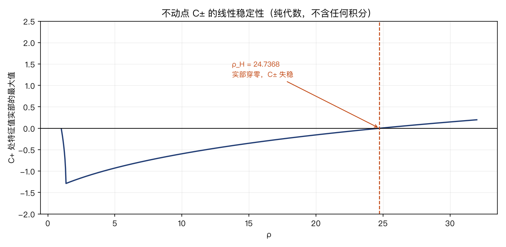

这张图是**纯线性代数**，不含任何积分：对每个 ρ 解析地写出 C+，算 Jacobian 的特征值，取实部最大者。它在 ρ_H 处穿零。下面的分岔图是积分出来的，拿来对照代数预言的位置：

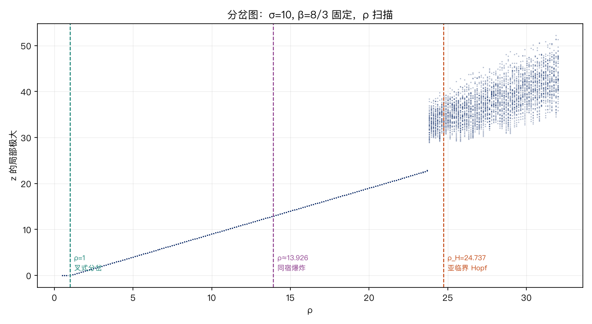

**纵轴是什么。** 固定一个 ρ，从 (1,1,1) 出发先积 140 个时间单位甩掉暂态，再积 50 个，把这段里 z(t) 每个波峰（ż = xy − βz 由正转负处）的高度记下来，竖着点在这个 ρ 上。一列点就是这条轨道的 z 能冲到哪些高度：

- 落到不动点：峰高收拢到同一个数，一列缩成一个点；
- 周期轨道：每周期 k 个峰，一列 k 个点；
- 混沌：峰高永不重复，一列铺成一条带。

取 z 有两个原因。对称 (x,y)→(−x,−y) 不改变 z，两叶的峰落在同一根轴上；取 x 会得到正负镜像的两支。z 也就是传热：Nu = 1 + 2z/ρ（§1.2），z 的峰就是传热的一阵阵峰。6.2 节的 Lorenz 映射用的是同一串峰值，这张图 ρ=28 那一列就是那张映射轴上的取值范围。

三条竖线依次是 ρ=1（叉式分岔，C± 诞生）、ρ≈13.926（同宿爆炸）、ρ_H=24.737（Hopf）。从左往右读：

- **ρ<1**：一列压在 0 上，原点稳定。
- **1<ρ≲23.7**：一列缩成一点，正好在 **ρ−1**，即 C± 的 z 坐标。ρ 过 1.35 后 C± 的特征值成复数：虚部让轨道绕 C+ 转，z 因此有峰；实部为负让每圈的振幅乘一个小于 1 的数，峰高收拢到 ρ−1。所以峰没有消失，只是收敛了。ρ>ρ_H 时实部变正，同样的螺旋改为往外转。
- **同宿爆炸那条线上图里什么也没变。** ρ≈13.926 生出的是一个不吸引的混沌集：轨道路过它要先在两叶间游荡一阵，再被 C± 收走。分岔图只记轨道最后去了哪里，所以看不见它。游荡的时长实测（6 个初值）：ρ=23.0 约 50 个时间单位，ρ=23.5 约 80，ρ=23.83 多数超过 20000。
- **带在 ρ≈23.8 就出现了，比 ρ_H 早将近 1。** 这一段 C± 仍然稳定：ρ=24.5 时从 C+ 旁出发，约 200 个时间单位落到 C+（3.1 节 ρ=24.5 那格画的就是这一幕）。混沌吸引子与稳定的 C± 共存，看到哪个取决于初值，这张图从 (1,1,1) 出发，落在混沌那边。文献给混沌集变成吸引子的阈值是 ρ≈24.06（Sparrow 1982）；它下面的 23.83、23.96 两列是上一条那种暂态，长过了这张图积分的 190 个时间单位。

所以三条线里，图上能直接看到的只有 ρ=1。ρ_H 是 C± 失稳的地方，混沌在它之前就到了，这正是 2.3 节说的亚临界。

ρ=28 位于 ρ_H 右侧：**三个不动点全部不稳定，没有任何稳定的稳态可去**。轨道既不能停下，又不能跑掉，只能永远在有界区域里游荡。奇怪吸引子由此而来。

---

## 3. 相图：本征结构与正交化

上一节全是代数。这一节把同样的结论画出来——五张图：ρ 变化时相空间长什么样、Jacobian 的特征值指向哪里、Poincaré 截面怎样认出轨道的类型并把三维流压成一条一维映射、以及计算 Lyapunov 谱时"每一步做正交化"到底在做什么。

### 3.1 四个 ρ 下的相图

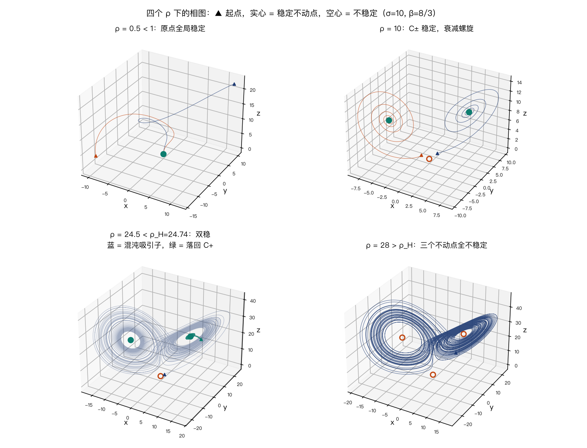

四格对应 2.3 节那三个阈值划出的四个区间：

- **ρ=0.5 < 1**：只有原点，且全局稳定。任何初值都直接落上去，没有振荡余地。
- **ρ=10 ∈ (1, ρ_H)**：原点已成鞍点（空心），C± 稳定（实心）。两个初值各自以**衰减螺旋**落向一侧——这正是 3.2 节里那对复特征值的样子：实部为负（收缩），虚部不为零（旋转）。
- **ρ=24.5 < ρ_H**：C± 在线性意义上**仍然稳定**，可是混沌吸引子已经存在。蓝色轨道在两叶间游荡，绿色轨道则被困在 C+ 附近的一个小环里。这是亚临界 Hopf 的典型后果：失稳阈值 ρ_H 之下就已经出现了另一个吸引集，"轨道去哪"变成了吸引域的问题而不是 ρ 的问题。注意绿环很小——C+ 的吸引域到这里已经被挤得很窄。
- **ρ=28 > ρ_H**：三个不动点全空心。没有稳态可去，蝴蝶出现。

**画相图时容易被忽略的一点**：这四格都**不丢瞬态**。本文其他所有图都先积 50 个时间单位再开始记录，因为瞬态里的统计量没有意义；而这一节要看的恰恰是瞬态——轨道是怎么落到吸引集上的。

### 3.2 Jacobian 的特征值与本征方向

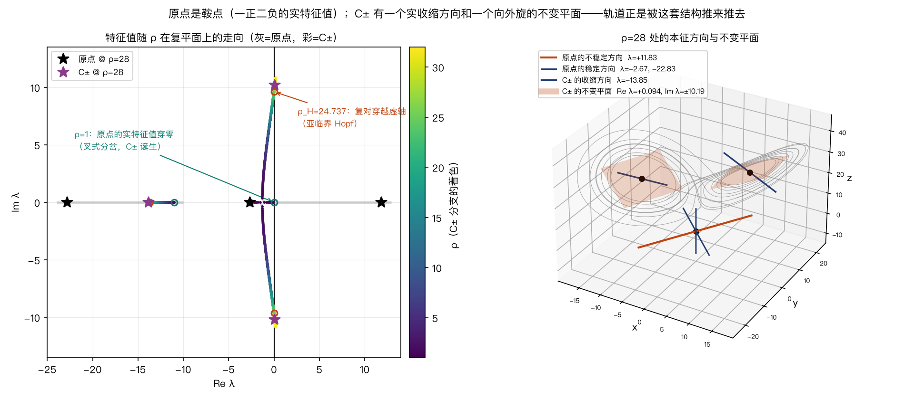

左图是 ρ 从 0 扫到 32 时，Jacobian 特征值在复平面上走过的路径（灰=原点，按 ρ 着色的=C±）。两次失稳的**方式完全不同**：

- ρ=1 处，原点的一个**实**特征值从左向右穿过原点——叉式分岔，C± 就此诞生；
- ρ_H=24.737 处，C± 的一对**复共轭**特征值穿过虚轴——Hopf。穿越点是 ±9.6246 i：实部变号而虚部不为零，于是失稳的形式是"旋转着往外走"而不是"直着跑开"。（穿越时第三个实特征值恰好是 −13.6667 = tr J，因为另外两个的实部此刻为零——这是 2.1 节那个恒等式的一个小小副产品。）

ρ=28 处的三组特征值（★）是：

```
原点   +11.827723,  −2.666667,  −22.827723        三个实数，一正二负 → 鞍点
C±     −13.854578,  +0.093956 ± 10.194505 i       一实一对 → 收缩方向 + 向外旋的平面
```

右图把这些数字放回相空间。原点的正特征值给出一条**不稳定方向**（红），轨道沿着它被推出去；两个负特征值给出两条稳定方向（蓝）。C± 处那对复特征值不对应两条实的本征方向，而对应一张**实的不变平面**——Re(v) 与 Im(v) 张成的那张，图中是半透明的红片；轨道在这张平面里旋转着向外，同时沿着实特征方向（蓝线）被压进来。

蝴蝶的两叶就是这么来的：每一叶是一个 C± 的不变平面附近的螺旋外流，而原点的那条不稳定方向是两叶之间的通道。**吸引子的形状是这套线性代数的直接后果**，不是巧合。

### 3.3 Poincaré 截面：先认三种典型，再看 Lorenz

**截面是什么。** 盯着一整条三维轨道看，线越画越乱，看不出规律。Poincaré 的办法是在轨道必经的地方竖一块平面，轨道每沿同一方向穿过它一次，就在平面上记一个点，其余全部扔掉。连续的流变成一串点 P₀, P₁, P₂, …；流是确定的，所以 P_n 决定 P_{n+1}，这条规则

$$
P_{n+1} = F(P_n)
$$

叫**首次回归映射**（Poincaré 映射）。三维的流变成平面上的映射，少了一维；时间换成了"第几圈"。

两条规矩：**只记一个方向**的穿越，否则每圈记两次；平面要**横着切**流，让轨道每圈都穿过它而不是贴着滑过。Lorenz 取 z = ρ−1，正是 C± 的高度，每一叶上的螺旋绕一圈都要从下往上穿过它一次。

值得这么做，是因为**轨道是哪一类，直接写在点集的形状上**。图 19 并排放了四个例子，上排是轨道与截面，下排是截面上的点，数字是第几次穿越：

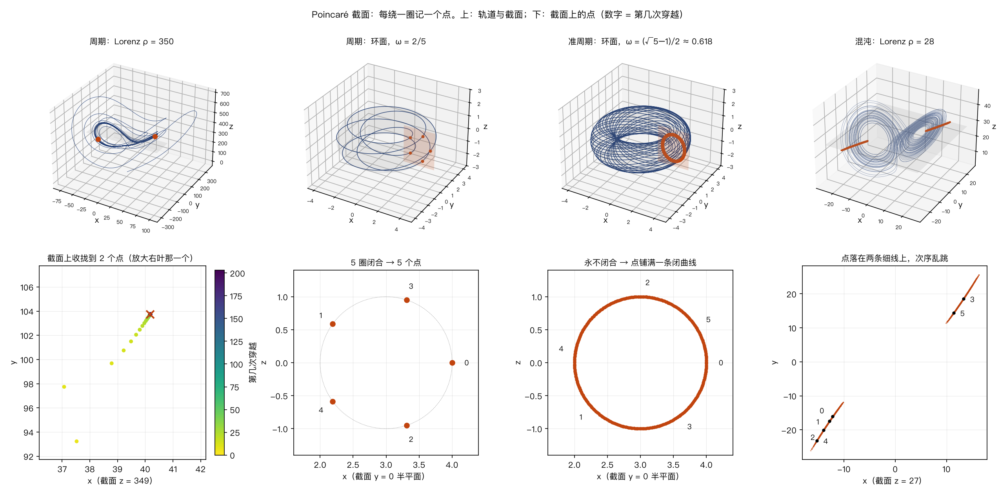

**周期：有限个点。** 先看例子。Lorenz 在 ρ=350 有一条稳定的周期轨道，左叶右叶各绕一圈就闭合，周期 0.3885。每个周期它从下往上穿过 z=349 两次，一叶一次，所以截面上只有两个点 ±(40.18, 103.74)。从 (1,1,1) 出发，开头几次落得很散，之后沿一条线一步步靠拢（左下格放大了右叶那个点）：同一叶上每回来一次，离极限点的距离乘 **0.75**。

这个 0.75 可以心算。ρ=350 的 Lyapunov 谱是 (0, −0.73, −12.94)，三者之和 −13.67 = tr J，和 2.1 节对得上。λ₁=0 对应沿轨道的方向：沿着轨道推一下，只是早到或晚到，截面上看不出来。截面上能看到的是 λ₂：走一个周期缩小 e^{−0.73×0.39} = e^{−0.28} ≈ 0.75。

一般地，每个周期穿过截面 k 次的周期轨道，在截面上是 k 个点，F 让它们轮流出现。稳定就是近邻收拢到这 k 个点上。

**两频运动：周期还是准周期，取决于频率比。** Lorenz 没有准周期的区间，所以借教科书上的例子：轨道在一个环面上同时转两个圈，绕大圈的角速度是 1，绕管子的小圈的角速度是 ω：

$$
\dot\theta_1 = 1,\qquad \dot\theta_2 = \omega
\quad\Longrightarrow\quad \theta_1 = t,\quad \theta_2 = \omega t .
$$

两个角互不相干，方程是线性的，没有一点非线性。把两个角放到三维里，取大圈半径 R = 3、管子半径 r = 1（fig19 用的就是这两个数）：

$$
x = (R + r\cos\theta_2)\cos\theta_1,\quad
y = (R + r\cos\theta_2)\sin\theta_1,\quad
z = r\sin\theta_2 ,
$$

消掉两个角，就是环面本身 $\left(\sqrt{x^2+y^2}-R\right)^2 + z^2 = r^2$：沿大圈任一方向切开，截口都是圆心离轴 R、半径 r 的圆。

截面取 y=0、x>0 的半平面，即 θ₁ = 2πn，正好把管子切开，截口就是这个圆。轨道每绕大圈一周（用时 2π）回到截面一次，这段时间里 θ₂ 走了 2πω，即在小圈上转了 ω 圈，第 n 个点落在 $(x, z) = (R + r\cos 2\pi\omega n,\ r\sin 2\pi\omega n)$。所以回归映射就是一个转动：

$$
\theta_{n+1} = \theta_n + \omega\ \text{圈}.
$$

- **ω = 2/5**：每次转 2/5 圈 = 144°。0° → 144° → 288° → 72° → 216° → 360°，第 5 次回到起点，截面上是 **5 个点**，访问顺序是跳着的（图中编号）。一般地，ω = p/q 时轨道转 q 圈闭合，截面上 q 个点，是周期轨道。
- **ω = (√5−1)/2 ≈ 0.618**：每次转 222.5°，等于反着转 137.5°，就是向日葵的黄金角。ω 是无理数，所以永远回不到起点；每个新点都插进旧点之间的空隙，400 个点已经把圆画满了。截面上是**一条闭曲线**，这就是**准周期**。

声学里最熟悉的准周期是两个纯音叠加。频率比是有理数时，李萨如图闭合；是无理数时，李萨如图永不闭合，最后铺满整个矩形。周期和准周期的区别就这么多。

准周期的点**次序**看起来是乱跳的，但它和混沌有本质区别：转动是刚性的。相邻两点每一步转同样的角度，间距永远不变，既不收拢也不散开，两个 Lyapunov 指数都是 0。所以准周期完全可预报：知道 ω 就能直接写出第一百万个点在哪；ω 差 δ，n 步后也只偏 nδ 圈，误差线性增长，不是指数增长。

**混沌：点落在细线上，近邻被拉开。** Lorenz ρ=28 的点既不会收拢到有限几个，也不会铺满一条光滑闭曲线，而是落在**两条细线**上（下一段细读）。右下格标出的 0–5 是图 14 蛛网走的那六次穿越：先在左叶上沿线往外爬，然后被甩到对面，再甩回来。和准周期真正的区别不在点集的形状，而在近邻怎么走：相邻两点每过一圈距离乘上 |F′| > 1，几十圈后就拉开到吸引子那么大。细线放大后是一层一层的（Cantor 式结构，就是 D_KY = 2.06 里的那 0.06），在这个尺度上分辨不出来。

| | 截面上 | 回归映射 F | 近邻 | Lyapunov 指数 |
|---|---|---|---|---|
| 稳定不动点（ρ=10） | 点列收拢到 C± 本身 | 一个稳定不动点 | 收拢 | 全负 |
| 周期 | k 个点 | 在 k 个点间轮换 | 收拢 | 0, −, − |
| 准周期 | 一条闭曲线 | 无理转数的转动 | 间距不变 | 0, 0, − |
| 混沌 | 有层次的细线 | 拉伸再折叠 | 指数散开 | +, 0, − |

一句话：截面把"轨道是哪一类"变成"点集是什么形状"，再由"近邻怎么走"来区分准周期和混沌。

**Lorenz 的截面。** 下面细读 ρ=28 这一格。

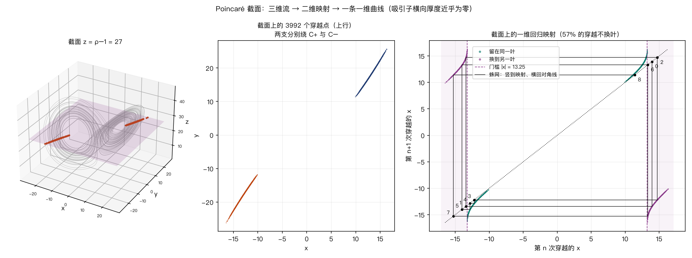

取平面 z = ρ−1 = 27（即 C± 所在的高度），只记录向上穿越的点。T=3000 的轨道穿越了 **3992 次**。

左格是这 3992 个点落在截面上的样子：不是一片云，而是两条**细线**——左右各一条，分别绕着 C− 与 C+。为什么是线：每一叶是一张贴着 C± 不变平面的薄片（3.2 节），薄片横切一个平面，切口就是一条线。线细到在这个尺度上看不出宽度，这就是 D_KY=2.06 的几何含义。

每条线又按「下一次是否换叶」分成两截：靠中心的一截（绿）下一圈还在本叶，靠外的一截（紫）下一圈换到对面。两条线各两截，就是中间那格回归映射的**四段**。

中间一格把截面压成一维：把第 n 次穿越的 x 对第 n+1 次的 x 作图，**56.7% 的穿越留在同一叶**。这张图和 6.2 节那张 Lorenz 映射（z 的极大值序列）是两条独立的降维路线，得到的结论一致：**三维的混沌流，其长期行为由一条一维映射编码**。而那条映射处处 |F′|>1，所以它的任何不动点都不可能稳定——混沌的来源。

读这张图时记住：**一个点是一步，不是一个位置**。按左右对称把符号去掉，只看离中轴多远的 |x|，整张图就是一条带门槛的规则，门槛在 |x| ≈ 13.25（紫色虚线，外侧浅紫的带是换叶区）：

- **|x| < 13.25 → 留在本叶（绿）**，下一圈的 |x| 更大。轨道在一叶上绕圈向外，就是点沿绿色分支一步步往上爬：9.9 附近一步只涨一点，越往外一步跨得越大。
- **|x| > 13.25 → 换到另一叶（紫）**。落点由越过门槛多少决定，而且是**反着的**：越过 1 以上（|x| 在 15.5–16.5），落到对面的 9.9–11.1，贴近中心，要在那一叶上绕好几圈才出得来；只越过一点点（13.25–13.6），落到对面的 14.2–16.5，已经在门槛外，**下一次立刻又换回来**。

所以紫色可以连续出现：换叶之后紧接着再换的概率是 47%，和换叶的总体比例 43% 差不多；3992 次穿越里最长一串连换 9 次（RLRLRLRLRL）。一叶上连续绕的圈数从 1 到 14 不等，只绕 1 圈就走的最多。哪一种全由那一个 |x| 决定，而 |x| 每步都被拉开（|F′|>1）——门槛附近差一点，后面绕几圈、换几次就全不一样。

右格是同一张映射上的**蛛网图**，把连续 5 步走出来：从对角线上的点竖直走到映射曲线，读出下一次的 x；再水平走回对角线 y=x，那个值就成了新的出发点。留叶的一步（绿）只在对角线附近挪一小格；换叶的一步（紫）竖线穿过横轴到对面，横线再横穿整张图回到对角线另一头：

| 步 | x | 落在哪 | 下一步 |
|---|---|---|---|
| 0, 1 | −12.2, −12.8 | 门槛内 | 留，往外绕 |
| 2 | −14.0 | 门槛外，越过 0.7 | 换，落到 13.3 |
| 3 | 13.3 | 门槛外，只越过 0.06 | 换，落得最远 |
| 4 | −15.3 | 门槛外，越过 2 | 换，落到中心附近 |
| 5 | 11.4 | 门槛内 | 在右叶上绕好几圈 |

0→1→2 是沿绿色分支往外爬到门槛；2→3→4→5 连换三次，其中 3→4 是「刚越过门槛就被甩到对面最外圈」，4→5 是「越过得多反而落到对面中心」。

### 3.4 Lyapunov 指数与 QR 重正交化

**先说结论。** 扰动每走一小段 Δt，就乘一次 I + J(u)Δt；而 J 里有 x、y、z（§2.1），轨道走到哪一点它就是哪个矩阵。所以 M(t) 是一长串**各不相同**的矩阵连乘，没有一组共用的本征方向，指数不能从哪一个 J 的特征值读出来，只能沿轨道一段一段算。随手跟三个扰动向量，它们会一起倒向当下拉得最狠的方向，量出来三个都是 λ₁。办法是边算边整理：每走一段，把三个向量重新正交化（Gram–Schmidt，也就是 QR），记下第 k 个向量在前 k−1 个之外又被拉长了多少；三本账各自的平均增长率就是 λ₁、λ₂、λ₃。下面逐句落实。

**λ 是什么。** 用 §2.0 的记号：轨道旁的小扰动满足 δu̇ = J(u(t)) δu，解是 δu(t) = M(t) δu₀，M′ = J M、M(0) = I。M(t) 把初始扰动送到 t 时刻。Lyapunov 指数是它的长期对数增长率：

$$
\lambda = \lim_{t\to\infty} \frac{1}{t}\ln\frac{|M(t)\,\delta u_0|}{|\delta u_0|}.
$$

随手取一个 δu₀，得到的都是最大的那个 λ₁。三个指数 λ₁ ≥ λ₂ ≥ λ₃ 要这样读：一般的线段按 $e^{\lambda_1 t}$ 长，一般的平行四边形面积按 $e^{(\lambda_1+\lambda_2)t}$ 长，体积按 $e^{(\lambda_1+\lambda_2+\lambda_3)t}$ 长。

**为什么不能直接取 J 的特征值。** J 是常数时可以：M = e<sup>Jt</sup>，λ 就是特征值的实部（§2.3 在不动点上用的正是这个）。吸引子上 J 沿轨道一直在变——§4.2 沿吸引子采样，特征值实部从 −21.9 到 +10.6，36% 为正——M 是一长串不同矩阵的乘积，乘积的增长率不是各个因子特征值的平均。只有一个例外：迹。由 Liouville 公式 det M = exp∫tr J dt，体积的增长率可以直接从 J 读出来，所以**三个指数之和**等于 tr J 的时间平均；单个指数没有这样的捷径。

**板书的例子。** 每过一个时间单位，x 方向拉长 2 倍、y 方向压扁一半：每步乘 diag(2, 1/2)，两个指数是 ±ln 2 = ±0.69。拿两个向量 v₁ = (1, 0)、v₂ = (1, 1) 去跟，n 步之后

$$
v_1 = (2^n,\ 0),\qquad v_2 = (2^n,\ 2^{-n}).
$$

- v₂ 的长度约 2ⁿ，量出来的增长率是 +ln 2：又是 λ₁。
- v₂ 与 v₁ 的夹角约 2⁻ⁿ / 2ⁿ = 4⁻ⁿ。n = 10 时 4⁻¹⁰ ≈ 10⁻⁶ 弧度，两个向量已经分不开。
- −ln 2 藏在 v₂ 那个越来越小的 y 分量里，被 2ⁿ 的 x 分量盖住了。

把 v₂ 沿 v₁ 的分量减掉（Gram–Schmidt），剩下 (0, 2⁻ⁿ)，长度的增长率是 −ln 2：λ₂ 出来了。也可以从面积看：v₁、v₂ 张成的平行四边形面积是行列式 2ⁿ · 2⁻ⁿ − 0 = 1，永远不变，所以 λ₁ + λ₂ = 0，λ₂ = −λ₁。

**QR 就是这一步 Gram–Schmidt。** 把 M 的三列做 QR 分解 M = QR，Q 的列正交归一，R 上三角。Gram–Schmidt 逐列做的事和上面一样，于是对角元各有几何意义：

- |R₁₁| = 第一列的长度 → 增长率 λ₁；
- |R₁₁R₂₂| = 前两列张成的平行四边形面积 → λ₁ + λ₂；
- |R₁₁R₂₂R₃₃| = |det M|，体积 → λ₁ + λ₂ + λ₃。

ln|R<sub>kk</sub>| 量的是"第 k 列在前 k−1 列张成的空间之外长出来的那一部分"，除以时间就是 λ<sub>k</sub>。

**为什么隔一段做一次。** 把 [0, T] 切成窗口，第 k 个窗口的 M 记为 M<sub>k</sub>，从上一个窗口留下的正交标架 Q<sub>k−1</sub> 出发再做 QR：M<sub>k</sub>Q<sub>k−1</sub> = Q<sub>k</sub>R<sub>k</sub>。连起来，

$$
M_n \cdots M_2 M_1 = Q_n\,R_n \cdots R_2 R_1 .
$$

上三角矩阵相乘还是上三角，对角元就是各自对角元相乘。所以逐窗口累加 ln|R<sub>ii</sub><sup>(k)</sup>|，和最后对整个 M 做一次 QR，**数学上是同一个数**。分段只是记账方式不同；为什么在双精度下非分段不可，下面这张图给出实测。

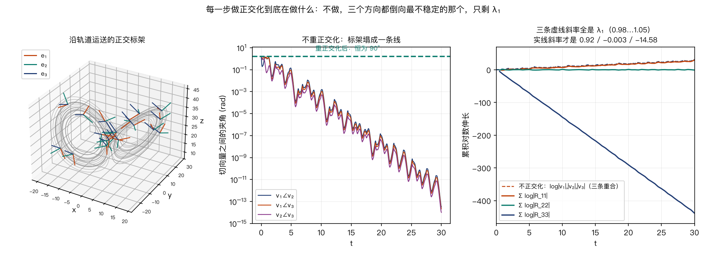

代码（`lyapunov.py` 的 Benettin 循环）：状态和 3×3 的切向量矩阵一起用 DOP853 积分一个窗口（Δt = 1），对切向量矩阵做 QR，把 ln|R<sub>ii</sub>| 加进累加器，用 Q 替换它，进入下一个窗口。左格画的是这个"运送着的正交标架"。

**如果不做正交化会怎样？**中间和右边两格是实测的对照（同一条轨道，同一个变分方程，只是从不做 QR）：

- **中格**：三个切向量两两之间的夹角从 90° 按指数塌向 0——到 t=30 时只剩 **3×10⁻¹⁴ 弧度**。这就是板书例子里的 4⁻ⁿ：一般的向量都含有最不稳定方向的分量，这个分量按 $e^{\lambda_1 t}$ 长，其余按更小的率长，于是三个向量都倒向同一条线，塌缩率约为 λ₁−λ₂。心算：这一段的有限时间 λ₁ 约 1.0（右格虚线的斜率），λ₂ ≈ 0，e<sup>−30</sup> = 10<sup>−30/2.3</sup> ≈ 10⁻¹³，实测 3×10⁻¹⁴。
- **右格**：三条虚线是不正交化时三个向量的 log 范数，斜率分别是 **0.98 / 1.01 / 1.05**——**全是 λ₁**（T=30 的有限时间涨落使它们略高于 0.904）。λ₂ 和 λ₃ 一点痕迹都没有。做了 QR 之后，三条实线（$\sum\log|R_{ii}|$ 的累积）的斜率才分开成 0.92 / −0.003 / −14.58（这一格是 T=200 的短跑，与 5.1 节 T=2000 的谱在第二位小数上一致）。

所以 QR 不是数值上的"清理"，而是**让 λ₂、λ₃ 可见的机制**：它每次把第 k 个向量投影到前 k−1 个的正交补上，保住那些正在被指数压扁的方向。"隔一段做一次"才是数值上的需要，原因有两条：

- **方向**：夹角到 10⁻¹⁶ 就低于双精度的分辨率，那时第二列减掉第一列的分量只剩舍入误差，λ₂ 再也取不回来。按 λ₁ ≈ 0.9 心算，ln(10¹⁶)/0.9 ≈ 41 个时间单位之后就是这样——和 5.2 节的双精度预报极限是同一个数，同一个 e<sup>λ₁t</sup> 吃掉同样的 16 位。窗口取 Δt = 1，每个窗口里夹角只缩 e<sup>−0.9</sup> ≈ 0.4 倍，毫无压力。
- **大小**：范数在 T=2000 时是 $e^{0.9\times 2000} = e^{1800}$，而双精度在 e<sup>709</sup> 就溢出。每个窗口把范数取出来放进累加器、把向量归一化，顺手解决。

**λ₂ 与 λ₃ 怎样心算。** λ₂ = 0：沿流方向的扰动 δu = ε f(u) 就是"同一条轨道早走 ε"，它随轨道走成 ε f(u(t))，有界、又不趋于零（轨道不停下），增长率是零。λ₃ 不用另算：三个之和是 tr J = −(σ+1+β) = −41/3 ≈ −13.67，所以 λ₃ = −13.67 − 0.90 − 0 = −14.57，与 5.1 节实测的 −14.570 对上。

**和式检验守什么、不守什么。** 由 QR 那三条的最后一条，每个窗口里 Σ ln|R<sub>ii</sub>| = ln|det M<sub>k</sub>| 都应当精确等于 tr J · Δt。实测前 50 个 Δt = 1 的窗口，每个窗口的 Σ ln|R<sub>ii</sub>| 都落在 −13.6666667 ± 2×10⁻⁷ 之内，而单窗口的 ln|R₁₁| 在 −1.9 到 +4.2 之间跳。所以 5.1 节的 Σλᵢ = tr J 守的是三件事：变分方程写对了、积分够准、QR 记账没错。三个指数**怎么分**这个总和，它管不到；λ₁ 单独的依据是 5.2 节的系综斜率 0.875，那条路根本不解变分方程。

---

## 4. 数值这一层：稳定性不是瓶颈

既然没有结构可保，就只剩下"算得准不准"。这里有一个常见的混淆要先拆开。先把它用到的工具 hλ 讲清楚。

### 4.0 工具回顾：hλ 是什么，稳定域是什么

**从三维到一个数。** 2.0 节的线性化把误差的演化写成 δu̇ = J δu。一步 h 之内 J 几乎不变，把它对角化，每个本征方向各自满足同一个标量方程

$$
\dot y = \lambda y,
$$

λ 是 J 的一个特征值。数值格式在每个方向上做的事，用这个最简单的方程就能看全。

**真解一步乘 e<sup>hλ</sup>。** 走 h 时间，ẏ = λy 的解乘上 e<sup>hλ</sup>。这个乘数只依赖 z = hλ 一个无量纲数。1/|λ| 是这个模自己的时间尺度，所以 |hλ| = h ÷ (1/|λ|) 读作"一步跨过这个模的几个时间尺度"。z 是复数，实部和虚部分开读：

- **h·Re λ**：一步里幅度的对数变化。h·Re λ = −0.22 就是一步缩到 e<sup>−0.22</sup> ≈ 0.80。
- **h·Im λ**：一步里转过的弧度。C± 处 λ = 0.094 ± 10.19i，h = 0.01 时一步转 0.10 弧度，绕一圈 2π/0.10 ≈ 62 步。

**格式一步乘 R(hλ)。** 显式 Runge–Kutta 用在 ẏ = λy 上，一步就是 y<sub>n+1</sub> = R(hλ) y<sub>n</sub>，R 是 e<sup>z</sup> 的泰勒截断，叫稳定性函数：

$$
R_\text{Euler}(z) = 1 + z,\qquad
R_\text{RK4}(z) = 1 + z + \frac{z^2}{2} + \frac{z^3}{6} + \frac{z^4}{24}.
$$

RK4 与 e<sup>z</sup> 从 z⁵/120 那一项开始才不同。整个格式好不好，就看 R(z) 像不像 e<sup>z</sup>。

**拿吸引子上衰减最快的模算一遍。** λ = −21.85（4.2 节的 min Re λ<sub>J</sub>），时间尺度 1/21.85 ≈ 0.046。

| h | hλ | 真解 e<sup>hλ</sup> | RK4 的 R(hλ) | 读法 |
|---|---|---|---|---|
| 0.01 | −0.22 | 0.8037 | 0.8037 | 准，差 4×10⁻⁶ |
| 0.05 | −1.09 | 0.335 | 0.346 | 还像 |
| 0.12 | −2.62 | 0.073 | 0.78 | 不炸，但衰减率只剩真值的十分之一 |
| 0.15 | −3.28 | 0.038 | 2.03 | 每步翻倍，10 步放大 2¹⁰ ≈ 1000 倍（实算 1210） |

**稳定域就是 |R(z)| ≤ 1 的那片 z。** 衰减模的真解每步都在缩小。格式在这个 z 上若 |R| > 1，就把一个本该消失的模每步放大，这就是数值不稳定。它完全由 h 太大引起，是格式的产物，与方程的物理无关。RK4 的稳定域和负实轴交在 −2.785，所以衰减模要求 h|λ| < 2.785；Euler 的稳定域是以 −1 为圆心的单位圆，交在 −2。上表最后一行 hλ = −3.28，已经越过 −2.785。

**稳定 ≠ 准。** h = 0.12 那一行在稳定域里，不会炸，可每步乘的是 0.78 而不是 0.073。稳定只保证误差不被格式自己放大，不保证 R(hλ) ≈ e<sup>hλ</sup>。要准，就要 |hλ| 小。

**为什么只看衰减模。** 稳定性问的是：格式有没有放大真解里本该消失的东西。|R(z)| ≤ 1 是这个问题在衰减模上的写法。把真解和格式每步乘的数并排放：

| 模 | h | 真解每步乘 | 格式每步乘 | 读法 |
|---|---|---|---|---|
| 增长 Re λ = +10.55 | 0.01 | 1.1112939 | 1.1112938 | 一起长，长得一样快 |
| 衰减 Re λ = −21.85 | 0.01 | 0.8037 | 0.8037 | 一起缩 |
| 衰减 Re λ = −21.85 | 0.15 | 0.038 | 2.03 | 该缩成 4%，格式让它翻倍 |

- **增长模**：真解自己就有 |e<sup>z</sup>| > 1，格式给出 |R| > 1 是对的。要求它也满足 |R| ≤ 1，等于要格式把真实的增长压掉。这里只问 R 与 e<sup>z</sup> 差多少，是精度问题。4.3 节还要再说。
- **衰减模**：真解每步乘一个小于 1 的数，格式只要 |R| > 1 就把一个该死掉的分量越乘越大。舍入误差就够当种子：10⁻¹⁶ 每步翻倍，五十几步长到 O(1)。这是性质上的错，叫不稳定。
- **虚轴附近**（|e<sup>z</sup>| = 1）：|R| 略大或略小于 1，表现为幅度缓慢漂移，介于两者之间。

两种模还有一个区别，4.4 节用得上：增长模和慢模承载着解，振幅大，误差估计看得见它们，步长按它们的精度选；衰减模在轨道落上吸引子之后几乎没有振幅，误差估计看不见，管它的只剩稳定性。**增长模和慢模由精度管，衰减模由稳定性管。**

4.2 节把整片谱乘上 h 放进 RK4 的稳定域里，一次看全所有模。

### 4.1 两件被混为一谈的事

| | 是什么的性质 | 由什么决定 | 步长能改变吗 |
|---|---|---|---|
| **数值稳定性** | 方法 + 步长 | $h\lambda_J$ 是否落在稳定域内 | **能** |
| **Lyapunov 指数** | 流本身 | 方程的物理 | **不能** |

第二行值得说透。真解自己就在指数分离，λ₁>0 是方程的属性。把 h 调小并不会"压住" λ，它只减少**你注入的误差量**——而这些误差随后照样被 $e^{\lambda t}$ 放大。混淆这两件事会导致一个错误的期待：以为只要步长够小就能长时间跟住轨道。

### 4.2 在 Lorenz 上，稳定性远不是限制因素

沿吸引子采样 Jacobian 的特征值：

```
max |λ_J|          23.0009
min Re λ_J        -21.8502
max Re λ_J        +10.5525
实部为正的比例      36.3%
```

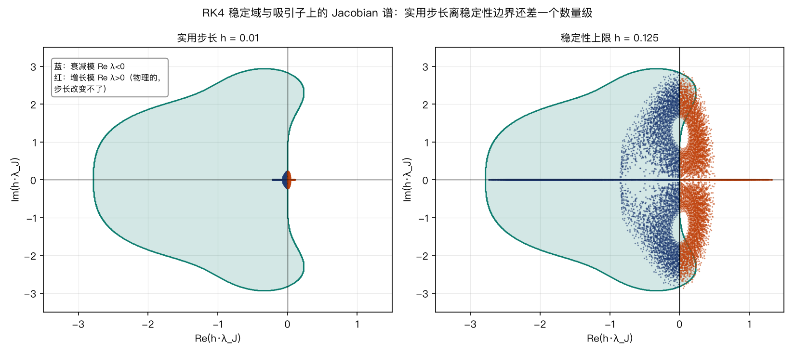

左图 h=0.01：整个谱缩成原点附近的一个小点，离稳定域边界还有一个数量级。右图 h=0.1253：衰减模（蓝）正好顶到边界。

数值给出的稳定步长上限是 **h < 0.1253**，与只看最强阻尼模的经典估计 $2.785/|{\rm min\,Re}\,\lambda_J| = 0.1275$ 一致。固定步长的 RK4 用的是 h = 0.01；全文其余计算用的自适应 DOP853 见 4.4 节。

**结论：Lorenz 上的瓶颈是精度，不是稳定性。** "我得限制 h 免得它炸掉"这句话在这里得到了正确的动作，但理由是错的。

### 4.3 一个必须小心的地方

右图里红色的点（Re λ>0 的增长模）**落在稳定域之外，而且永远如此**。这不是数值不稳定——那是格式在正确地复现物理上真实存在的增长方向。

如果按教科书直觉要求"整个谱都满足 $|R(h\lambda)|\le 1$"，会得到 h=0 这个荒谬答案：因为 $|R(h\lambda)| \approx |1+h\lambda| > 1$ 对任何 Re λ>0 和任何 h>0 都成立。**稳定域分析只对衰减方向有意义**。（`tests/test_stability.py::test_expanding_modes_do_not_veto_every_step` 检验的就是这一条：吸引子上存在增长模，`max_stable_step` 仍给出大于 0.01 的步长。）

### 4.4 自适应步长：稳定域还在，守它的换成了控制器

全文用的是 DOP853，步长由相对误差控制，不是人给的。稳定域在这里要分两层说。

**稳定域仍是格式的性质，和容差无关。** RK45 每步往前推的是 5 阶解，DOP853 推的是 8 阶解。把它们用在 ẏ = λy 上，一步同样是乘一个 R(hλ)，只是 R 换成了各自的多项式（由 Butcher 表算出：R(z) = 1 + z bᵀ(I − zA)⁻¹𝟙，`stability.stability_polynomial`）。稳定域照样是 |R(z)| ≤ 1，和负实轴交在（`stability.real_axis_limit`）：

| 格式 | 负实轴交点 | 衰减模要求 h < 交点 / 21.85 |
|---|---|---|
| RK4 | −2.785 | 0.127 |
| RK45（Dormand–Prince 5） | −3.31 | 0.151 |
| DOP853 | −6.39 | 0.293 |

阶数越高，R 贴着 e<sup>z</sup> 走得越远，稳定域也越大。rtol 是相对还是绝对，这张表都不变。

**容差决定的是控制器选哪个 h。** 嵌入式格式一步给出两个解，差 e 当作本步误差，按

$$
\text{err} = \sqrt{\frac13\sum_i \Big(\frac{e_i}{\text{atol} + \text{rtol}\,|u_i|}\Big)^2}\ \le 1
$$

接受这一步。放到 ẏ = λy 上，e = E(hλ)·y，E 由两套权重各自的 R 相减得到（`stability.error_function`，照 scipy 的误差范数逐项算）；纯相对容差下 |y| 约掉，条件变成 |E(z)| ≤ rtol。这是 z 平面上原点附近一小片固定的区域，可以叫**精度域**。rtol 越紧，精度域越小。

精度域是"这一个模承载了整个解"时的要求。方程组里，第 k 个模带振幅 c<sub>k</sub>，它在 err 里贡献 |E(hλ<sub>k</sub>)|·|c<sub>k</sub>| / (rtol·|u|)，所以它真正受的约束是 |E(hλ<sub>k</sub>)| ≤ rtol·|u| / |c<sub>k</sub>|。已经衰减掉的模 c<sub>k</sub> 很小，它的精度域被放大了 |u|/|c<sub>k</sub>| 倍，等于不受精度约束。于是 h 由承载解的那几个慢模的精度定下来，衰减模只是被乘上同一个 h，落到 hλ<sub>衰减</sub>。

于是只有两种情形：

- **衰减模的 hλ 落在稳定域里**：控制器为了慢模的精度选的 h，本来就比稳定性要求的小，稳定域碰不到。这时"瓶颈是精度"。
- **衰减模的 hλ 落到稳定域外**（容差很松，或者方程很刚性）：控制器会试一个 hλ 落在稳定域外的步。衰减模每步乘一个 |R| > 1，一开始小得看不见：相对容差拿 |u<sub>i</sub>| 来衡量（吸引子上 |x|、|y| 平均约 7，z 约 24），rtol = 10⁻³ 时门槛约 0.01，一个 10⁻¹⁰ 的分量要每步翻倍二十几步才够得着。够着了，err 超过 1，这一步被拒，h 缩回来。结果 h 在稳定边界附近来回振荡：解不会炸，误差被压在容差的量级，但步数被稳定性定死了，再放松 rtol 也省不下步数。这就是刚性在操作上的定义（Hairer–Wanner II，§IV.2）。

所以问"自适应格式的稳定域"，答案是：稳定域还是 R(z) 那一片，一点没变；变的是谁来守它。固定步长时由人事先选 h 守住；自适应时由误差估计事后发现、拒步守住，代价是被拒的步。

**Lorenz 上属于第一种。** 在吸引子上积 100 个时间单位，看控制器实际选的最大步长（`stability.adaptive_step_usage`）：

| rtol | RK45 最大 h | 占稳定上限 | DOP853 最大 h | 占稳定上限 |
|---|---|---|---|---|
| 10⁻³ | 0.139 | 0.92 | 0.296 | 1.01 |
| 10⁻⁴ | 0.098 | 0.64 | 0.245 | 0.84 |
| 10⁻⁶ | 0.045 | 0.29 | 0.135 | 0.46 |
| 10⁻⁹ | 0.013 | 0.09 | 0.061 | 0.21 |
| 10⁻¹³ | 0.0021 | 0.01 | 0.021 | 0.07 |

（atol = 10⁻¹⁵；"占稳定上限"是 h × 21.85 / |交点|，用整个吸引子上最强的阻尼，偏保守。）按这个算法，rtol = 10⁻³ 时 DOP853 已到 1.01；逐步算 h<sub>n</sub>·λ<sub>J</sub>(u<sub>n</sub>)，最远是 −4.79，只占 0.75。真正开始碰边界的是 RK45 在 10⁻³：有 0.2% 的衰减模点落到稳定域外。全文用到的容差是 10⁻⁴ 到 10⁻¹³，都在第一种情形里。最松的 10⁻⁴ 已用掉 0.84，离边界不远；rtol = 10⁻¹³ 时最大步只用掉稳定上限的 7%。自适应只是把"瓶颈是精度"说得更彻底：步长本来就是按精度选的。

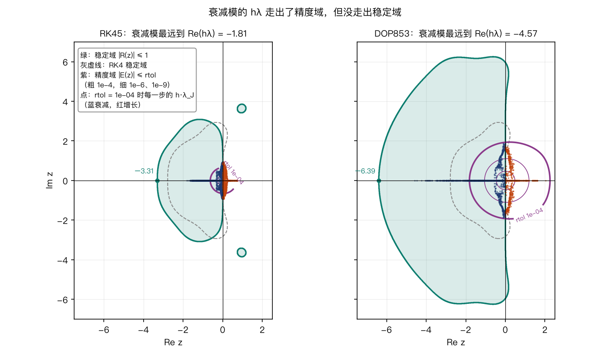

图 20 把三样东西画在同一个 z 平面上：绿色是稳定域 |R(z)| ≤ 1，紫色是精度域 |E(z)| ≤ rtol，点是 rtol = 10⁻⁴ 时控制器每一步的 h<sub>n</sub>·λ<sub>J</sub>(u<sub>n</sub>)（`stability.controller_spectrum`）。沿负实轴读三个数：

| 格式 | 精度域（10⁻⁴）到 | 衰减模 hλ 最远到 | 稳定域到 |
|---|---|---|---|
| RK45 | −0.63 | −1.81 | −3.31 |
| DOP853 | −1.81 | −4.57 | −6.39 |

（两个 1.81 是巧合。）中间那一列比左边远，这正是上面说的：沿负实轴那条蓝线是 λ ≈ −22 的强收缩方向，轨道已经贴在吸引子上，这个方向的分量早衰减没了，控制器不管它的精度，把它一路带出了精度域。中间那一列又比右边近，所以稳定性没被碰到。DOP853 的稳定域比 RK45 大近一倍，同一个 rtol 下它的步长大 2.5 倍，用掉的比例更高（0.72 对 0.55），但都还在里面。

### 4.5 阶数什么时候值钱

常听到的说法是"阶数越高的格式，步长越小越有优势"。方向对，要改两处：RK45、DOP853 是显式格式，给非刚性问题用，刚性问题恰恰是这条规律失效的地方；自变量是精度要求，不是步长，步长是控制器按 rtol 选出来的结果。改过之后：

**非刚性问题里，精度要求越紧，阶数高的格式越划算。**

**规律从哪里来。** p 阶格式每步误差 ∝ h<sup>p+1</sup>。要把误差压到 tol，步长只能取 h ∝ tol<sup>1/p</sup>，总工作量

$$
\text{nfev} \propto \frac{s}{h} \propto s\cdot \text{tol}^{-1/p},
$$

s 是每步求几次 f（RK45 6 次，DOP853 12 次）。在 log nfev 对 log 误差的图上，这是斜率 −1/p 的直线。阶数高，线平：精度每紧一个数量级，工作量涨得少。但截距高：每步更贵。一条陡而起点低，一条平而起点高，两条线必然相交。交点以上（容差松）低阶便宜，交点以下高阶便宜，而且越往下差得越多。工作量之比按 tol<sup>1/p<sub>低</sub> − 1/p<sub>高</sub></sup> 长；p = 5 对 p = 8，每个数量级是 10<sup>1/5 − 1/8</sup> = 10<sup>0.075</sup> ≈ 1.19 倍。

**Lorenz 上实测**（`efficiency.work_precision`）。在吸引子上积到 t = 2（λ₁t ≈ 1.8，混沌只把误差放大 e<sup>1.8</sup> ≈ 6 倍，量到的是格式的误差），rtol 从 10⁻³ 到 10⁻¹²，和 10⁻¹³ 的参考解比：

| | RK45 | DOP853 |
|---|---|---|
| 拟合斜率 | −0.17 | −0.10 |
| 理论 −1/p | −0.20 | −0.125 |
| 误差 10⁻¹⁰ 要的 nfev | 6100 | 1440 |

两条斜率都比理论略平（松的一端步数有个下限，要几十步才把轨道画出来），但差值 0.17 − 0.10 = 0.07，每个数量级 10<sup>0.07</sup> ≈ 1.18 倍，和上面心算的 1.19 对上。两条线在误差 10⁻⁴ 到 10⁻⁶ 之间交汇；到 10⁻¹⁰，DOP853 便宜 4 倍多。

**反例：刚性问题里阶数不帮忙。** 步长被稳定域卡住时，h ≈ 交点 / |λ|，总工作量

$$
\text{nfev} \approx s\cdot\frac{|\lambda|\,T}{\text{交点}},
$$

和 tol 无关，也和阶数无关。三个格式的 s / 交点：

| 格式 | 每步求值 s | 交点 | s / 交点 |
|---|---|---|---|
| RK4 | 4 | 2.79 | 1.44 |
| RK45 | 6 | 3.31 | 1.81 |
| DOP853 | 12 | 6.39 | 1.88 |

稳定域大致只随求值次数线性长大，阶数高换来的大稳定域被每步更贵抵消干净，DOP853 一点便宜都占不到。

拿 y′ = −1000 (y − cos t) 积到 T = 10 实测（`efficiency.stiff_work`）。解慢慢跟着 cos t 走，偏离它的分量以 λ = −1000 衰减。心算：RK45 要 10 × 1000 / 3.31 ≈ 3020 步，DOP853 要 10 × 1000 / 6.39 ≈ 1560 步；乘上 s，都是一万八千多次求值。实测 rtol = 10⁻² 到 10⁻⁴，RK45 接受 3025 步，DOP853 1567 步，几乎就是心算值，而且三个容差下一步不差。nfev 是两万一对一万九：RK45 多出的部分是被拒的步，正是 4.4 节说的 h 在稳定边界上来回振荡。rtol 紧到 10⁻⁶ 以下，慢模的精度要的 h 比稳定性还小，精度重新接管，两条线才开始往上走。

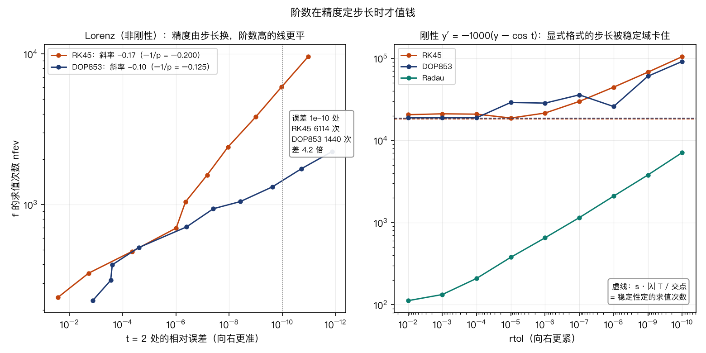

图 21 左边是 Lorenz：两条线斜率不同，往右（更准）越拉越开。右边是刚性问题：两个显式格式贴着同一条虚线 s·|λ|T / 交点 走平台，平台上 rtol 松几个数量级都不省求值；绿线 Radau 在 rtol = 10⁻² 时只用 112 次，便宜近两百倍，它的斜率约 −0.22，接近 5 阶的 −1/5。

**刚性求解器是隐式格式**（BDF、Radau）。稳定性不再卡步长，阶数重新起作用，但碰上别的限制：

- **Dahlquist 第二壁垒**：A-稳定的线性多步法最高 2 阶。BDF 3 到 6 阶的稳定域一个比一个小，7 阶以上不稳定。
- **隐式 RK** 可以又高阶又 A-稳定（Radau IIA 是 5 阶），代价是每步解一个 s·n 维的非线性方程组。

所以刚性求解器的阶数一般停在 5 左右，不会像 DOP853 那样做到 8 阶。

**非刚性问题里的两条边界。**

- **舍入误差下限。** rtol 逼近 10⁻¹³ 到 10⁻¹⁴，舍入误差占主导，再高的阶数也压不下去。`REFERENCE_RTOL` 停在 10⁻¹³ 就是这个原因。
- **解要足够光滑。** 误差常数里含解的高阶导数。解里有尖峰、不连续或事件切换，高阶导数很大，"高阶 = 小误差"就不成立。

**一句话**：非刚性问题里，阶数越高，工作量对精度的依赖越平，精度要求越紧越划算；刚性问题里步长被稳定性卡住，显式格式的阶数几乎不起作用。

---

## 5. 可预报性的崩塌

### 5.1 Lyapunov 谱，以及凭什么相信它

用 Benettin 算法（变分方程 + 周期 QR 重正交化，机制见 3.4 节）积分 T=2000：

$$
\lambda = (\ +0.903764,\ -0.000411,\ -14.570019\ )
$$

λ₂≈0 是应该的：任何有界非定常流沿流方向都有一个零指数（3.4 节末）。

**诚实点 2：λ₁ 本身是个数值结果，凭什么信它？**

这里有一个不需要拟合、不需要调参的精确检验。对任何流，

$$
\sum_i \lambda_i = \left\langle \operatorname{tr} J \right\rangle
$$

而 Lorenz 的 tr J 是**常数** −13.6666666667。所以计算出的谱必须精确地加和到这个值：

```
Σ λ_i      = -13.666666669
tr J（精确）= -13.666666667
偏差        =  2.17e-09
```

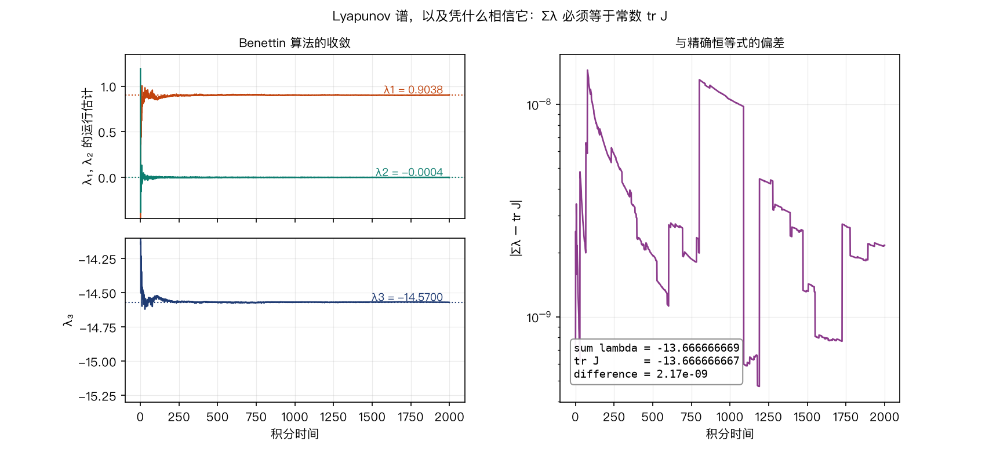

这个恒等式同时是 `tests/test_lyapunov.py::test_spectrum_sums_to_the_divergence` 的断言。如果变分方程写错、QR 记账错、或者积分精度不够，这个和会明显偏掉。它守的是总和，三个指数怎么分这个和它管不到（3.4 节末）；λ₁ 单独的依据是下一节没有共用代码的系综斜率。

由谱可得 Kaplan–Yorke 维数

$$
D_{KY} = 2 + \frac{\lambda_1}{|\lambda_3|} = 2.062001
$$

吸引子体积为零（$\sum\lambda_i<0$），却比曲面更厚——分形。

### 5.2 误差怎么长

沿一条轨道每隔 5 个时间单位取一个点，共 16 个吸引子点，每个点沿 4 个随机方向扰动 δ₀=1e-9，全部用参考精度积分。只扰动一个点量到的是那一段轨道的有限时间指数——换一个起点，[5,15] 上的斜率可以落在 0.4 到 1.3 之间；把散布在吸引子上的点合在一起取中位，才是 λ₁ 的估计：

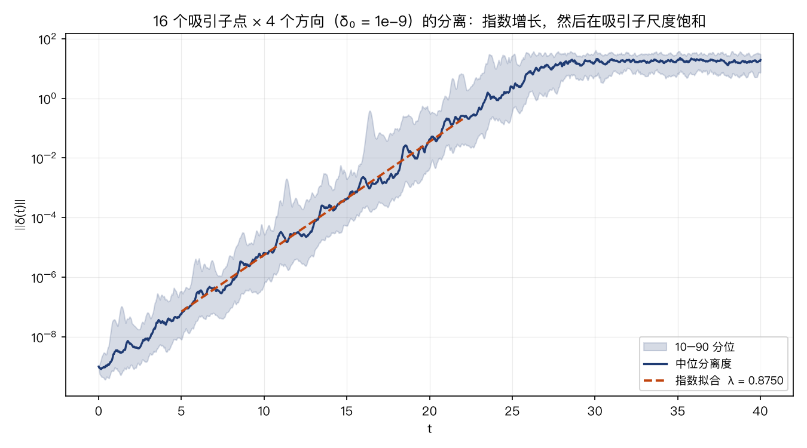

中位分离度在 t∈[5,22] 内呈干净的指数，拟合斜率 **0.8750**——与 Benettin 的 0.9038 相差 3.2%，而这两条路径**没有共用任何代码**（一个解变分方程，一个只是扰动初值）。之后曲线在吸引子直径处饱和：误差不会无限增长，它只是增长到"毫无信息"为止。

由此得到两个数字：

- 倍增时间 $\ln 2/\lambda_1 = 0.767$
- 双精度预报极限 $\ln(10^{16})/\lambda_1 = 40.76$ 个时间单位

第二个数字的意思是：即便算法完美无误差，仅仅因为初值在双精度下只能表示到 $10^{-16}$，**超过约 41 个时间单位之后你算的就不再是你想要的那条轨道**。

### 5.3 核心证据：精度只换来对数的时间

上面是理论推断。下面是直接测量。

对每个容差，用 DOP853 积分并与 rtol=1e-13 的参考解比较，记录首次分离超过 1 的时刻 T_div，在 8 个不同起点上平均：

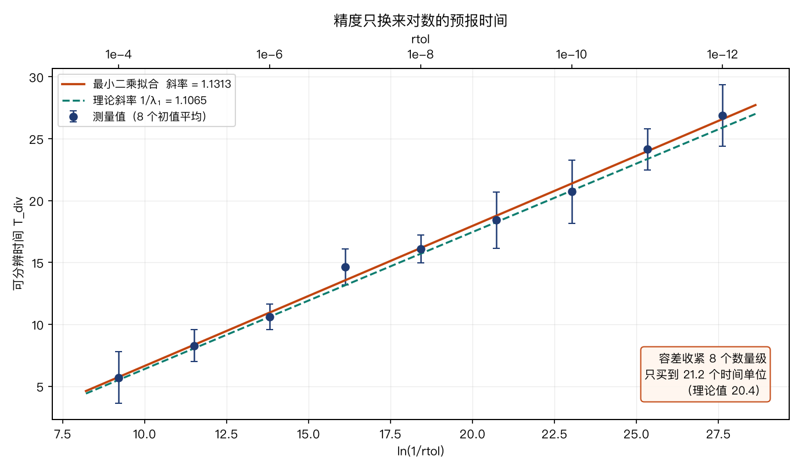

T_div 对 ln(1/rtol) 是**一条直线**。这正是 $T_{\rm div} = \lambda_1^{-1}\ln(\Delta/\delta_0)$ 与 $\delta_0 \propto {\rm rtol}$ 的预言。

| rtol | 1e-4 | 1e-6 | 1e-8 | 1e-10 | 1e-12 |
|---|---|---|---|---|---|
| T_div | 5.69 | 10.62 | 16.11 | 20.71 | 26.88 |

- 拟合斜率 **1.1313**，对应 λ₁ = 0.8839（比 Benettin 的 0.9038 低 2.2%，因为"有效初始误差"并不严格正比于 rtol，只是同阶）
- 理论斜率 $1/\lambda_1 = 1.1065$
- **容差收紧 8 个数量级，只买到 21.2 个时间单位**（理论值 $8\ln 10/\lambda_1 = 20.4$）
- 折成每一位：**多一位精度只多 $\ln 10/\lambda_1 \approx 2.55$ 个时间单位**

把这句话说得再直白一点：从 rtol=1e-4 改到 1e-12，DOP853 的步数约多 10 倍（8 阶方法，步数随 rtol 的 −1/8 次方增长），换来的预报时间从 5.7 涨到 26.9。**想再多要 20 个时间单位，需要再收紧 8 个数量级——而双精度已经到头了。**

所以第 0 节那个问题的答案是：**在 t>41 这个范围里，"哪条对"这个问题本身没有答案。** 提高精度不是一条可行路线，因为回报是对数的。

### 5.4 顺带回答：局部 Lyapunov 指数

全局 λ₁=0.904 是个长时间平均。局部的拉伸率差别极大：

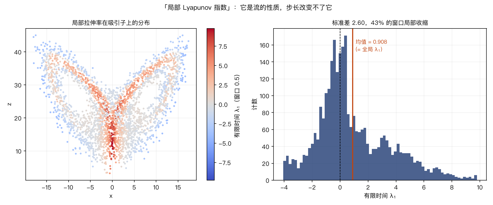

取 0.5 长的窗口计算有限时间 λ₁：均值 0.908（正好是全局值），但标准差 **2.60**，取值范围 [−4.07, +9.79]，而且 **42.7% 的窗口是局部收缩的**。

这张图给了 4.1 节那个表格一个具体的样子。在局部指数大的区域（图中红色，主要在两叶交界与外缘）注入的误差会被放得最狠，所以在那里减小步长**确实有用**——自适应控制器也确实会那么做。但理由是"减少注入的误差量"，不是"压住 λ"。λ 是流的性质，0.5 个时间单位里它可以是 9.8，步长取多少都改变不了这件事。

---

## 6. 那还剩下什么可信？

到此为止全是坏消息。但 Lorenz 吸引子的图片出现在每一本教科书上，它们显然不是幻觉。什么东西撑住了？

### 6.1 影随（shadowing）

直觉是这样的：一条局部误差很小的数值轨道，虽然不是你要的那条真解，但它可能**指数逼近另一条真解**——只是初值稍有不同。如果是这样，你画出来的蝴蝶就是真的蝴蝶，只是不是"你那只"蝴蝶。

对一致双曲系统，这件事有定理（影随引理）。

**诚实点 3：Lorenz 不是一致双曲系统，严格的影随引理不适用。**

Lorenz 吸引子含有一个不动点（原点），这破坏了一致双曲性。真正成立的结果弱一些也晚得多：Tucker 2002 用计算机辅助证明（Smale 第 14 问题）确立了 Lorenz 吸引子存在，且是一个**奇异双曲**吸引子，具有结构稳定性。数值影随方面的结果通常是**有限时间**的、逐案验证的，不是一个可以随手引用的全局定理。

所以影随不能当作"所以数值解可信"的护身符。它提示了方向，但真正的辩护必须是**可测量的**。

### 6.2 可测量的辩护：统计量不动

下面是本文的中心实验。三次计算：DOP853，rtol 分别取 1e-6、1e-9、1e-13，同一初值。

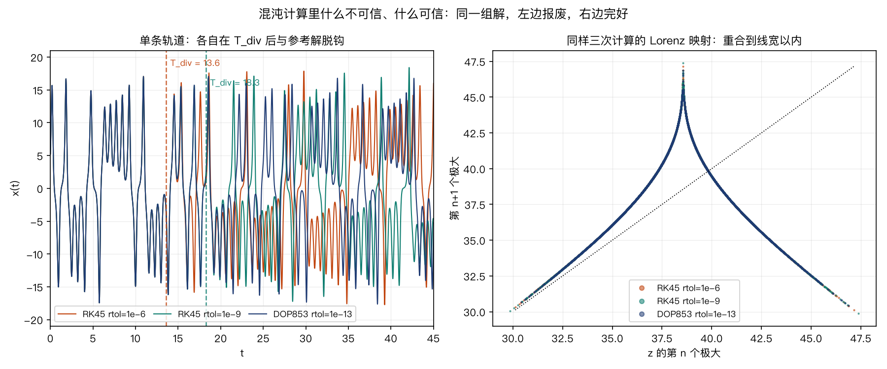

**左边**：三条 x(t)。测出来的脱钩时刻是 T_div=10.5 和 18.3，之后三条曲线彼此无关。按单条轨道的标准，前两次计算是废品。

顺带一个值得注意的事实：图中那条 rtol=1e-13 相对于参考解也会在 **t=33.3** 脱钩——两者唯一的差别只是 `atol` 取 1e-15 还是 1e-16。连"最好的两次计算之间"都撑不过 34 个时间单位，这和 5.2 节算出的双精度极限 40.76 是同一回事。

**右边**：同样这三次计算的 Lorenz 映射——把 z 的第 n 个局部极大画在横轴，第 n+1 个画在纵轴（Lorenz 1963 年原文的构造）。三种颜色**重合到线宽以内**。

这张图就是全文的论点。同一组数据，左边报废，右边完好。

这条尖顶曲线的厚度（除去局部斜率之后的残差散布）是 z 值域的 **8.6×10⁻⁵**，即 0.0086%。它还告诉我们混沌从哪来：**曲线的斜率处处大于 1**，所以该映射的任何不动点都不可能稳定。

### 6.3 不变密度与 Poincaré 截面

同样的对照对密度成立：

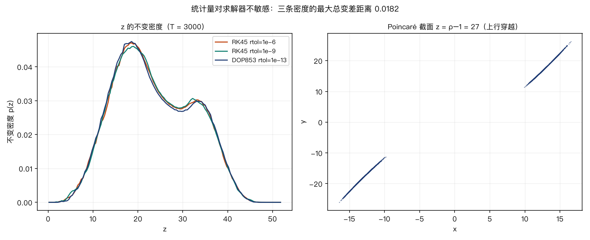

三个容差下 z 的不变密度（T=3000）之间的**最大总变差距离是 0.0099**，即 1.0%——而这个残差主要来自有限采样，不是容差差异。

这些结论也被写成了测试：`tests/test_statistics.py::test_lorenz_map_is_tolerance_independent` 与 `test_invariant_density_is_tolerance_independent`。

### 6.4 吸引子本身

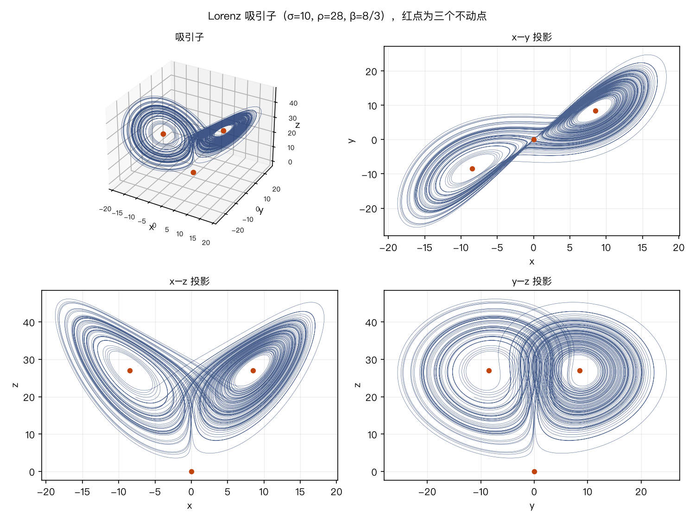

最后，那只蝴蝶。红点是三个不动点：原点（鞍点，一正二负实特征值）和两叶各自盘绕的 C±。轨道在两叶间的切换是非周期的，而切换序列恰恰是 6.2 节那条一维映射所编码的东西。

---

## 7. 判据要随系统类型而变

把前面几节收拢成一句话：**"这个数值结果可信吗"不是一个可以脱离系统类型回答的问题。**

| 系统类型 | 可保的结构 | 验证手段 | 长时间单条轨道 |
|---|---|---|---|
| 保守（哈密顿） | 辛形式、不变量 | 能量有界？辛/分裂格式 | **可信**（误差多项式增长，辛格式下线性） |
| 耗散、非混沌 | 收敛到吸引子 | 是否收敛到正确稳态/极限环 | 可信 |
| **混沌** | **无** | **统计量对方法不敏感？** | **不可信（超过 1/λ₁ 量级）** |

三行各自对应一套工程实践：

**第一行**：这是分子动力学、天体力学的世界。$H=T(p)+V(q)$ 可分离，于是存在**显式且辛**的格式——Verlet / 蛙跳，以及它们的高阶复合（Yoshida）。验证手段是监视能量：辛格式下它有界震荡不漂移。

图 17 在 Kepler 问题（偏心率 0.6）上把这一行算出来。RK4 每步算四次力，Verlet 算一次，所以对比时取 $h_\text{RK4}=4h_\text{Verlet}$，两者代价相同。

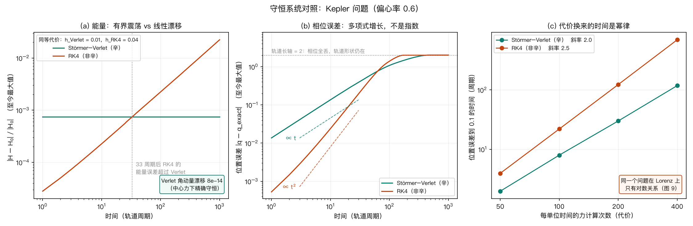

- **(a) 能量**：Verlet 的相对能量误差停在 $7.4\times10^{-4}$，跑 1000 个周期也不涨；RK4 的随时间线性漂移，33 个周期后超过 Verlet，1000 个周期时到 $2.2\times10^{-2}$。Verlet 的角动量漂移是 $8\times10^{-14}$，即舍入误差：中心力下它精确守恒角动量。
- **(b) 相位误差**：Verlet 的位置误差 $\propto t$，RK4 的趋向 $\propto t^2$（能量漂移变成频率漂移，Hairer–Lubich–Wanner 定理 X.3.1）。两者最终都饱和在轨道长轴 2——相位丢了，但辛格式下能量与角动量还在，轨道的形状没丢。
- **(c) 代价换时间**：把"位置误差到 0.1"的时间对代价作图，两条都是幂律，Verlet 斜率 2.0（误差 $\sim h^2 t$），RK4 斜率 2.5。

(c) 里 RK4 的线在 Verlet 上面：同等代价下，四阶方法的相位反而保持得更久。辛格式买到的不是更准，而是**不漂**——能量有界、误差只线性增长，所以跑得越久它越占优。对本文的论点更要紧的是另一件事：两条线都是幂律。守恒系统里精度换来的是成倍的时间，图 9 里的 Lorenz 只换来对数的时间，这就是表里第一行和第三行的分界。

（`tests/test_hamiltonian.py::test_symplectic_error_grows_linearly_and_rk4_faster` 检验 (b) 的增长指数；`test_verlet_horizon_is_a_power_law_in_the_step` 检验步长减半、时间翻四倍。）

**第三行**：Lorenz 在这里。没有能量可监视，单条轨道在 41 个时间单位后失去意义。验证协议要换成：把容差扫几个数量级、把方法换几种，检查 λ₁、$D_{KY}$、不变密度、Lorenz 映射是否稳定。本文 6.2–6.3 就是在执行这套协议。

**一个直接的推论**：在混沌问题上做收敛性研究时，不要画"误差 vs 步长"然后期待看到 $O(h^p)$ 的直线。误差在超过可预报时间后会饱和到吸引子直径，斜率图会变成一条水平线，看起来像"格式失去精度阶"——其实格式没问题，是被测量的对象没有意义了。要验收敛阶，必须在 $t \ll 1/\lambda_1$ 的短窗口内做。（`tests/test_integrate.py::test_tighter_tolerance_is_more_accurate_before_saturation` 因此只比较到 t=8；同样的比较放到 t=30，三个容差都已饱和，误差的大小顺序就是随机的。）

### 回到声学

第一行和声学直接相关。无耗散波动方程是哈密顿系统，Yee 的 FDTD 格式中 $E$ 与 $H$ 在时间上交错半格——那**就是一个蛙跳格式，也就是一个辛积分器**。这是 FDTD 能长时间运行而不出现数值能量爆炸或人工衰减的结构性原因，而不是运气。

第三行则对应非线性声学、声致湍流一类问题：一旦系统进入混沌，单次实现的波形就不该被当作可复现的预报，该报告的是谱、相关函数、统计矩。

---

## 附录 A：复现

```bash
uv sync --all-groups
uv run pytest                  # 全部断言，含 Σλ 恒等式与 T_div 斜率
uv run ruff check src tests
uv run lorenz63 info           # 本文引用的全部数字
uv run lorenz63 figure all     # 重建 report/figures/ 下全部图
```

删除 `.cache/` 后重跑 `figure all` 应得到相同结果——所有随机扰动方向与随机起点都由固定 seed 生成。全部图约 4.3 分钟（约 260 s，其中 fig03 分岔扫描一个人就占 54 s，fig17 的 Kepler 长跑占 36 s）。

## 附录 B：数字汇总

| 量 | 值 | 来源 |
|---|---|---|
| tr J（相空间散度） | −13.6666666667 | 闭式 |
| C± | (±8.485281, ±8.485281, 27) | 闭式 |
| ρ 叉式分岔 | 1 | 闭式 |
| ρ 同宿爆炸 | ≈13.926 | 文献（Sparrow 1982） |
| ρ 混沌集变成吸引子 | ≈24.06 | 文献（Sparrow 1982） |
| ρ_Hopf | 24.7368421053 | 闭式 |
| 原点的特征值 | +11.827723, −2.666667, −22.827723 | 闭式 |
| C± 的特征值 | −13.854578, +0.093956 ± 10.194505 i | 闭式 |
| λ₁ | +0.903764 | Benettin, T=2000 |
| λ₂ | −0.000411 | Benettin, T=2000 |
| λ₃ | −14.570019 | Benettin, T=2000 |
| Σλᵢ 与 tr J 的偏差 | 2.17×10⁻⁹ | 自洽检验 |
| λ₁（系综独立估计） | 0.8750 | 16 点 × 4 方向 |
| λ₁（容差斜率独立估计） | 0.8839 | T_div 拟合 |
| D_KY | 2.062001 | λ 谱 |
| 倍增时间 | 0.766956 | ln2/λ₁ |
| 双精度预报极限 | 40.76 | ln(10¹⁶)/λ₁ |
| max\|λ_J\|（吸引子上） | 23.0009 | 采样 |
| RK4 稳定步长上限 | 0.1253 | 仅衰减模 |
| RK45 / DOP853 稳定域负实轴交点 | −3.31 / −6.39 | 4.4 节 |
| DOP853 最大步长占稳定上限 | 0.84（rtol 10⁻⁴）→ 0.07（10⁻¹³） | 4.4 节 |
| Lorenz 映射厚度 | 8.6×10⁻⁵ | z 值域的比例 |
| 不变密度最大总变差 | 0.0099 | 三个 rtol 间 |
| 有限时间 λ₁ 标准差 | 2.60 | 窗口 0.5 |
| z=27 截面的穿越次数 | 3992 | T=3000，上行 |
| 截面上不换叶的比例 | 56.7% | 回归映射 |
| ρ=350 周期轨道：周期 | 0.3885 | 两次上行穿越各 0.1942 |
| ρ=350 周期轨道：截面上的点 | ±(40.18, 103.74) | z=349，上行 |
| ρ=350 的 Lyapunov 谱 | 0.0008 / −0.7307 / −12.9368 | Benettin, T=2000 |
| ρ=350 近邻每周期收缩 | 0.75 | e^{λ₂T} |
| 不正交化时的切向量夹角 | 90° → 3.2×10⁻¹⁴ | t=0 → t=30 |
| 不正交化得到的三个"指数" | 0.983 / 1.007 / 1.046 | 全是 λ₁ |
| Kepler：Verlet 能量误差上界 | 7.4×10⁻⁴ | h=0.01，1000 周期 |
| Kepler：RK4 能量误差 | 2.2×10⁻² | h=0.04，1000 周期 |
| Kepler：RK4 能量误差超过 Verlet | 第 33 周期 | 同等代价 |
| Kepler：Verlet 角动量漂移 | 8×10⁻¹⁴ | 舍入误差 |
| Kepler：误差到 0.1 的时间对代价的斜率 | 2.0（Verlet）/ 2.5（RK4） | 幂律 |

## 附录 C：从两个 PDE 到三个 ODE

做法是 Galerkin 投影：选一组满足边界条件的空间函数，把场写成"时间系数 × 空间函数"之和，代进 PDE，再把方程投影到每个函数上，得到各系数的 ODE。只保留少数几个函数就是截断。

记 k = πa/H（水平波数），m = π/H（竖直波数），K² = k² + m² = (π/H)²(1+a²)。三个模态都满足 §1.2 的自由滑移条件：

$$
\psi = A(t)\,\sin kX\,\sin mZ,\qquad
\theta = B(t)\,\cos kX\,\sin mZ \;-\; C(t)\,\sin 2mZ .
$$

**投影**就是乘上某个模态、在一个卷对（0<X<2H/a，0<Z<H）上积分。正弦余弦两两正交，所以等价于"展开后比较同一个模态前面的系数"，下面直接这样做。用到的雅可比记号是 ∂(f,g)/∂(X,Z) = f<sub>X</sub>g<sub>Z</sub> − f<sub>Z</sub>g<sub>X</sub>。

**涡度方程。** ∇²ψ = −K²ψ，ψ 是 ∇² 的本征函数，所以 ∂(ψ,∇²ψ)/∂(X,Z) = −K²·∂(ψ,ψ)/∂(X,Z) = 0：单个模态的自平流为零，x 方程因此是线性的。浮力项里 C 的模态不含 X，求 ∂/∂X 后消失，只剩 B：

$$
-K^2\dot A = \nu K^4 A - g\alpha k\,B
\;\Rightarrow\;
\dot A = -\nu K^2 A + \frac{g\alpha k}{K^2}\,B .
$$

**温度方程。** 线性项各自留在原模态里：(ΔT/H)ψ<sub>X</sub> = (ΔT/H)kA cos kX sin mZ；κ∇²θ = −κK²B cos kX sin mZ + 4κm²C sin 2mZ。非线性项逐对算：

$$
\frac{\partial(\psi,\ B\cos kX\sin mZ)}{\partial(X,Z)} = AB\,km\,(\cos^2 kX + \sin^2 kX)\sin mZ\cos mZ = \frac{km}{2}AB\,\sin 2mZ ,
$$

X 依赖整个消掉了：**卷搬运温差，产生的正好是一个水平均匀、只随 Z 变的模态**——这就是 z 必须被保留的原因。

$$
\frac{\partial(\psi,\ \sin 2mZ)}{\partial(X,Z)} = 2km\,A\cos kX\,\sin mZ\cos 2mZ = km\,A\cos kX\,(\sin 3mZ - \sin mZ) .
$$

sin mZ 那部分落回 y 的模态，给出 −xz 项；**sin 3mZ 不在保留的三个模态里，扔掉——截断就发生在这一步。**

比较 cos kX sin mZ 与 sin 2mZ 的系数：

$$
\dot B = \frac{\Delta T}{H}k\,A - \kappa K^2 B - km\,AC,\qquad
\dot C = \frac{km}{2}\,AB - 4\kappa m^2\,C .
$$

**无量纲化。** 令 τ = κK²t（即 §1.2 的 π²(1+a²)κt/H²），三式各除以 κK²：

- A 的衰减率变成 ν/κ = σ；
- C 的衰减率变成 4m²/K² = 4/(1+a²) = β；
- B 的衰减率变成 1。

再把 A、B、C 各乘一个常数（就是 §1.2 那组标度），把非线性项的系数调成 1，就得到标准形式。ρ 怎么来，看两个线性耦合系数的乘积就够了，它不受 A、B 标度的影响：

$$
\sigma\rho = \frac{g\alpha k}{\kappa K^4}\cdot\frac{\Delta T\,k}{H\kappa K^2}
\;\Rightarrow\;
\rho = \frac{g\alpha\Delta T\,k^2}{H\nu\kappa K^6}
= \mathrm{Ra}\cdot\frac{a^2}{\pi^4(1+a^2)^3} = \frac{\mathrm{Ra}}{\mathrm{Ra}_c(a)} .
$$

**Nusselt 数。** 底板 Z=0 处，水平平均后 B 项的 cos kX 平均为零，只剩 C 项：∂T̄/∂Z = −ΔT/H − 2mC。除以传导斜率 −ΔT/H 得 Nu = 1 + 2πC/ΔT。按 §1.2 的标度 C = zΔT/(πρ)，于是 Nu = 1 + 2z/ρ。

## 附录 D：三次多项式的根，§2.3 用到的五件事

p(λ) = λ³ + a₂λ² + a₁λ + a₀，系数是实数。

**1. 系数是根的组合（Vieta）。** 根是 λ₁, λ₂, λ₃，就有 p(λ) = (λ−λ₁)(λ−λ₂)(λ−λ₃)。展开：

$$
a_2 = -(\lambda_1+\lambda_2+\lambda_3),\qquad
a_1 = \lambda_1\lambda_2+\lambda_2\lambda_3+\lambda_3\lambda_1,\qquad
a_0 = -\lambda_1\lambda_2\lambda_3 .
$$

例：根 −1, −2, −3，得 (λ+1)(λ+2)(λ+3) = λ³ + 6λ² + 11λ + 6。心算：1+2+3 = 6，2+6+3 = 11，1×2×3 = 6。对特征多项式，a₂ = −tr J，a₀ = −det J。三个根全负，三个系数就全正，所以"系数全正"是稳定的必要条件。

**2. 复根成对出现，三次式至少有一个实根。** 系数是实数，p(z) = 0 取共轭就得 p(z̄) = 0，所以复根总是 α ± iω 成对。三个根里去掉成对的，至少剩一个实根；λ→+∞ 时 p→+∞，λ→−∞ 时 p→−∞，中间必过零，也说明这一点。于是只有两种情形：三个实根，或者一个实根 −r 加一对复根：

$$
p(\lambda) = (\lambda + r)\left[(\lambda-\alpha)^2 + \omega^2\right] = (\lambda + r)(\lambda^2 - 2\alpha\lambda + \alpha^2 + \omega^2).
$$

α 是那对复根的实部，决定稳定性；ω 是旋转频率。

**3. 系数全正挡住的只是实根。** λ ≥ 0 时每一项 ≥ 0，a₀ > 0，所以 p(λ) > 0：没有非负实根。复根不受约束。反例 λ³ + λ² + λ + 2：实根约 −1.35，由第 1 条三根之和为 −1，复根对实部 (−1 + 1.35)/2 ≈ +0.18 > 0。

**4. 根随系数连续移动。** ρ 连续变，系数连续变，三个根在复平面上连续移动。从左半平面到右半平面必须越过虚轴。a₀ ≠ 0 时 λ = 0 不是根，所以越过的地方只能是 ±iω（ω ≠ 0），而且由第 2 条是共轭的一对同时越过。

**5. 判据 a₂a₁ > a₀ 从哪来。** 把第 2 条的分解展开，记 m = α² + ω²：

$$
(\lambda + r)(\lambda^2 - 2\alpha\lambda + m) = \lambda^3 + (r-2\alpha)\lambda^2 + (m-2\alpha r)\lambda + rm .
$$

于是

$$
a_2a_1 - a_0 = (r-2\alpha)(m-2\alpha r) - rm = -2\alpha r^2 - 2\alpha m + 4\alpha^2 r = -2\alpha\left[(r-\alpha)^2 + \omega^2\right].
$$

方括号恒正，a₂a₁ − a₀ 与 α 反号：a₂a₁ > a₀ ⇔ α < 0 ⇔ 复根对在左半平面。加上第 1 条的系数全正（保证实根 −r < 0），就是三次的 Routh–Hurwitz 判据。α = 0 时 a₀ = a₂a₁，p 分解成 (λ + a₂)(λ² + a₁)：穿越频率 ω² = a₁，第三个根 −a₂。

## 参考

1. E. N. Lorenz, *Deterministic Nonperiodic Flow*, J. Atmos. Sci. **20**, 130 (1963).
2. C. Sparrow, *The Lorenz Equations: Bifurcations, Chaos, and Strange Attractors*, Springer (1982).
3. W. Tucker, *A Rigorous ODE Solver and Smale's 14th Problem*, Found. Comput. Math. **2**, 53 (2002).
4. G. Benettin et al., *Lyapunov Characteristic Exponents for Smooth Dynamical Systems*, Meccanica **15**, 9 (1980).
5. E. Hairer, C. Lubich, G. Wanner, *Geometric Numerical Integration*, 2nd ed., Springer (2006).
6. J. C. Sprott, *Chaos and Time-Series Analysis*, Oxford (2003).
7. B. Saltzman, *Finite Amplitude Free Convection as an Initial Value Problem — I*, J. Atmos. Sci. **19**, 329 (1962).
8. H. Haken, *Analogy between Higher Instabilities in Fluids and Lasers*, Phys. Lett. A **53**, 77 (1975).
9. M. Gorman, P. J. Widmann, K. A. Robbins, *Nonlinear Dynamics of a Convection Loop*, Physica D **19**, 45 (1986).
10. S. H. Strogatz, *Nonlinear Dynamics and Chaos*, 2nd ed., Westview (2015), §9.1（Malkus 水车）.
